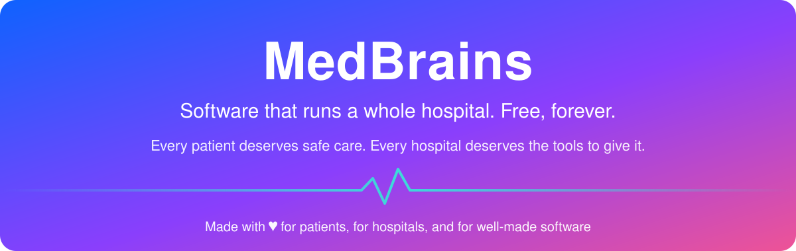
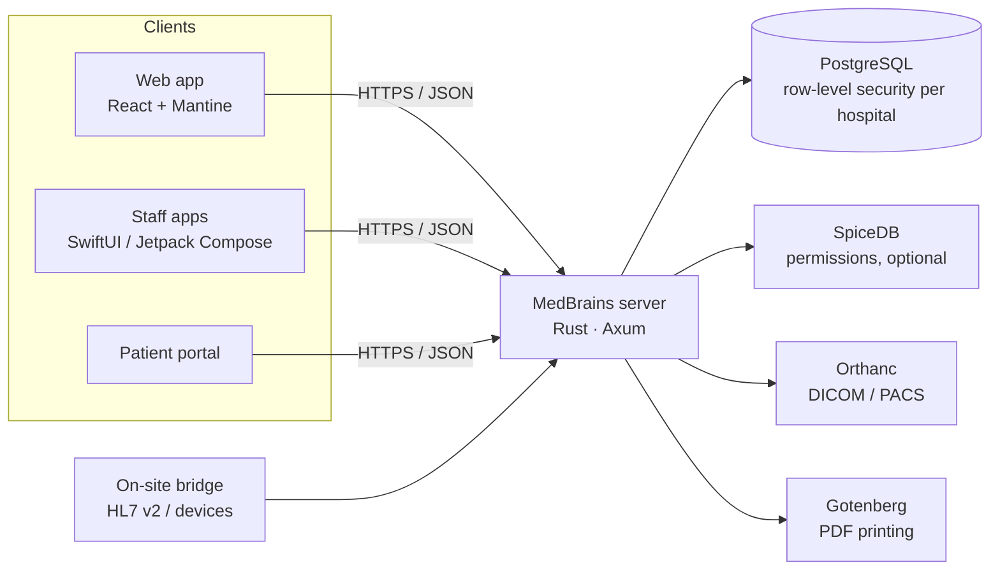

<div align="center">



[](#why-is-it-free)
[](#why-is-it-free)
[](#who-its-for)
[](#credits-and-contact)

# MedBrains

**Software that runs a whole hospital: registration, OPD, wards, pharmacy, lab, radiology, billing.**

**It is free. No licence fee, no per-user fee, ever.**

*Every patient deserves safe care, and every hospital, big or small, rich or poor, deserves the tools to give it. Built with love for patients, for hospitals, and for well-made software, so cost never stands between them.*

[](./LICENSE)
[](https://github.com/medbrains/medbrains/actions/workflows/ci.yml)
[](#why-rust)
[](./CONTRIBUTING.md)

[Website](https://medbrains.in) · [Features](#features) · [Quick start](#quick-start) · [Roadmap](#roadmap) · [Sponsor](#sponsor-the-work) · [Contribute](#contributing)

</div>

<!-- TODO: add screenshot — main dashboard (docs/screenshots/dashboard.png) -->

---

## In one minute

- **For doctors and nurses:** register a patient, see the OPD queue, write notes and prescriptions, admit to a ward, give medicines with barcode checks, order labs and scans. One patient record across every department.
- **For hospital owners:** the software costs nothing to use, on as many computers, staff and branches as you like. You can run it on your own server, and your data stays yours.
- **For IT heads:** one Rust server, one PostgreSQL database, a web app, and staff apps for iPhone and Android. The code is public, so you can check every line.

## Why is it free?

People reasonably ask what the catch is. Here is the whole answer:

- **The software is free forever** under the [Apache 2.0 licence](./LICENSE). You can use it, change it, and run it for any hospital, without asking us.
- **The code is public.** Anyone can read how it checks a drug interaction or who can see a record.
- **No licence fees, no per-user fees, no selling your data.** We never see your data unless you ask us to host it.
- **How the team earns:** only from *optional* setup, training, hosting and support for hospitals that want help. If you can run it yourself, you owe us nothing.

**Why we are doing this:** good hospital software is expensive and locks hospitals in. The places that need it most (small, rural and charitable hospitals) can least afford it. Patient-safety rules such as drug checks, consent and controlled-drug registers should be open to inspection, and free for anyone to run. MedBrains aims to be a [Digital Public Good](#digital-public-good) for health.

## Who it's for

| | |
|---|---|
| **Small and rural hospitals** | Run the full hospital on one small server, with no licence budget. |
| **Charitable and trust hospitals** | Every rupee goes to patients, not software fees. |
| **Multi-specialty hospitals** | Many departments, roles and branches, with fine-grained access control. |
| **Developers and health-tech teams** | A real, tested hospital codebase to learn from, extend, or build on. |

## Features

These features are built end to end: database, server and screen. Things that are only partly done are listed under [Roadmap](#roadmap) instead.

**Registration and front office**
- Patient registration with automatic UHID, photo, contacts, insurance and allergies
- Duplicate-patient check while you type (fuzzy name match), plus merge and unmerge
- OPD token queue (call, start, complete, no-show) and token display boards

**OPD (outpatient)**
- Case sheet / clinical notes with sign, countersign and revision history
- Prescriptions with drug-interaction checks
- Diagnosis search with ICD-10 and ICD-11 codes
- Duplicate-investigation warning, referrals, certificates and consents

**IPD (wards)**
- Admission, live bed board, discharge summary
- eMAR: medication rounds with barcode verification at the bedside
- Nursing charts: vitals, intake/output, pain, wounds, fall risk, shift handover, code blue

**Emergency**
- ER visits and triage
- Medico-legal cases (MLC) with injury records and police intimation

**Operation theatre**
- OT bookings and schedule, WHO-style safety checklist, anaesthesia record

**Pharmacy**
- Prescription queue and dispensing, stock with batches and expiry (first-expiry-first-out)
- NDPS register for narcotics; Schedule H / H1 / X rules enforced on the server
- Drug-interaction check; allergy conflicts block dispensing on the server
- Counter sales (OTC) and returns

**Laboratory**
- Orders, results, verification and amendments
- Critical-value alerts sent to the doctor's inbox
- Quality control (Westgard rules)

**Radiology**
- Orders and reports
- PACS link with [Orthanc](https://www.orthanc-server.com/) (open source): worklist and studies matched to orders

**Blood bank**
- Donors and eligibility, crossmatch with issue checks, transfusions and reaction reporting

**Billing and insurance**
- Invoices, packages, credit notes, refunds, GST returns
- Insurance / TPA claims and rate cards

**Stores, HR and payroll**
- Procurement and indents
- Staff, duty roster, attendance and duty hours
- Basic payroll: salary structures, payroll runs, payslips

**Reports and admin**
- Dashboards, report catalogue with CSV export, NABH quality indicators
- Self-service hospital onboarding
- Roles and permissions down to single actions, plus field-level access (hide a field from a role)
- Tamper-evident audit log (hash-chained, append-only) with export

**Patient portal**
- Patients can see their records, request refills, use teleconsultation, and manage privacy requests

**Staff mobile apps (native iPhone and Android)**
- Reception: register and find patients, OPD queue
- Doctor: consultation notes, IPD rounds
- Nurse: MAR schedule, give doses with barcode check, transfusion monitoring, code blue, shift handover

## Customise it for your hospital

You don't need a developer for most of this:

- **Roles and permissions.** Create your own roles and choose exactly what each one can see and do.
- **Field-level access.** Hide sensitive fields (for example, HIV status) from roles that don't need them.
- **Departments, wards, beds, services and prices.** All set up from the admin screens.
- **Your language.** The interface text is translatable.

Developers can go further, because the code is open: add a module, change a workflow, or connect your own devices.

## Standards and compliance

Only what the code does today:

| Standard | Status |
|---|---|
| **ICD-10 / ICD-11** | Diagnosis coding. ICD-11 uses the WHO ICD API container. |
| **HL7 v2** | MLLP listener on the on-site bridge, for lab analysers and devices. |
| **DICOM** | Through Orthanc: worklist and studies linked to radiology orders. |
| **HL7 FHIR R4** | Read API for `Patient` (including `$everything`), `Encounter`, `Observation`, `DiagnosticReport` and `Composition`. Write and search are on the roadmap. |
| **ABDM** | ABHA (M1) server integration exists and needs your ABDM credentials. Full M1–M3 is on the [roadmap](#roadmap). |
| **LOINC** | Lab tests carry a LOINC code field. The LOINC dataset is not bundled. |
| **SNOMED CT** | Optional. A loader script imports RF2 files you obtain yourself. SNOMED needs a licence: free in India through NRCeS, an affiliate licence elsewhere. No SNOMED content ships with MedBrains. |

**Privacy (India's DPDP Act, 2023):** MedBrains records patient consent, and tracks access, correction, erasure, nominee and grievance requests with due dates. It keeps a full audit trail, separates hospitals with database row-level security, and lets you restrict fields by role. Erasure requests are decided by a person, because medical records have legal retention periods. The software helps you comply; your hospital is still the data fiduciary.

## Your data is yours

- **Open database.** All data sits in a normal PostgreSQL database that you control. The schema is in the repo.
- **Patient download.** A patient can download their record as a FHIR R4 Bundle (JSON) from the portal.
- **CSV exports** for reports, analytics and the audit log.
- **Backups** with standard PostgreSQL tools; scripts and a restore guide are in [`medbrains/docs/ops/BACKUP-RESTORE.md`](medbrains/docs/ops/BACKUP-RESTORE.md).
- **No lock-in.** If you stop using MedBrains, your database is still yours, in an open format.

## Quick start

> Today the quick start is for developers. A single-command Docker setup for hospitals is on the [roadmap](#roadmap).

**You need:** macOS or Linux, Docker, Rust 1.85+ (`rustup`), Node 24 and pnpm 10. The first Rust build is large and takes a while; 16 GB RAM and about 60 GB of free disk are recommended.

```bash
git clone https://github.com/medbrains/medbrains.git
cd medbrains/medbrains
cp .env.example .env
make db              # PostgreSQL, SpiceDB, Gotenberg, mail server (Docker)
make dev-db-roles    # creates the app's database roles
make dev-backend     # builds and runs the server on :3000; migrations run automatically
```

In a second terminal:

```bash
cd medbrains/medbrains
pnpm install
pnpm dev:web         # web app on http://localhost:5173
```

**Sign in:** hospital code `DEFAULT`, username `admin`. In development, the password is shown on the sign-in page under "Dev credentials". Set `MEDBRAINS_SEED_ADMIN_PASSWORD` before the first start to choose your own. In production, the server refuses to start without it and asks for a new password at first sign-in. Set `MEDBRAINS_SEED_DEMO_DATA=true` for sample data.

To install at a hospital, see the on-site deployment kits in [`medbrains/deploy/`](medbrains/deploy/).

## Architecture



- **One server, many hospitals.** Each hospital's rows are kept apart by PostgreSQL row-level security, set per request.
- **SQL checked at compile time** with SQLx. A query that doesn't match the schema doesn't build.
- **Split into about 119 Rust crates** by department, so one department's change doesn't touch the rest.
- **Open dependencies.** PostgreSQL, Orthanc, SpiceDB and Gotenberg are all open source. Paid services such as SMS, email, payment gateways and AI are optional add-ons, and file storage can be S3 or local disk.

## Why Rust

- **Memory safety.** Rust rules out whole classes of crashes and security holes. `unsafe` code is forbidden in this project.
- **No surprise crashes.** Lints forbid `unwrap`, `expect`, `panic` and `todo`, so every error is handled.
- **Small and fast.** A single compiled server runs comfortably on modest hardware.

Measured numbers we have so far: across 16,779 requests from our automated smoke tests, the median API response was **7 ms**, p95 **54 ms** and p99 **97 ms**. These come from single-user test runs on a developer machine, not a load test. Load-test results will be published when we have them.

The test suite has about 1,500 Rust tests, 206 Playwright browser specs and 177 web unit-test files.

## MedBrains vs a typical commercial hospital system

| | MedBrains | Typical commercial system |
|---|---|---|
| Licence cost | Free | Upfront licence, often large |
| Per-user / per-bed fees | None | Common |
| Source code | Public, you can audit it | Closed |
| Your data | Open PostgreSQL, FHIR and CSV export | Often a vendor format; export may cost extra |
| Customisation | Change anything yourself, or hire anyone | Through the vendor only |
| Hosting | Your server, any cloud, or ours (optional) | Usually the vendor decides |
| Support | Community free; paid support optional | Bundled into the contract |

## Roadmap

**Partly built**
- **ABDM:** ABHA (M1) works on the server but has no screen yet. M2 (HIP), M3 (HIU), Scan & Share and NHCX claims are on development branches and not merged.
- **FHIR:** add search, write, and whole-hospital bulk `$export`.
- **LOINC:** load and map the LOINC dataset, beyond today's code field.
- **SNOMED CT:** connect the terminology client to the screens.
- **Inventory screens:** stores inventory is thin compared with procurement.
- **Payroll:** statutory PF / ESI filing.
- **Online payments:** only one payment gateway today. A provider-neutral layer is planned.
- **Native apps:** pharmacy, lab, radiology, OT and blood bank screens.
- **Allergy check on screen:** show the warning while prescribing, not only when dispensing.

**Planned**
- One-command Docker install for hospitals (server plus web in one compose file)
- Published load-test results
- Registration with the Digital Public Goods Alliance

## Digital Public Good

We are building MedBrains to meet the [Digital Public Goods Standard](https://digitalpublicgoods.net/standard/) and plan to apply for registration. It serves **SDG 3: Good Health and Well-being**, uses an open licence (Apache 2.0), runs on an open stack, and documents how it handles privacy. See [GRANTS.md](./GRANTS.md) for how it maps to each criterion.

## Get help

- **Community (free):** [GitHub Issues](https://github.com/medbrains/medbrains/issues) for bugs, [Discussions](https://github.com/medbrains/medbrains/discussions) for questions and ideas.
- **For hospitals (paid, optional):** setup, data migration, staff training, hosting and support contracts. Contact us through [medbrains.in](https://medbrains.in).
- **Security issues:** please don't open a public issue. Follow [SECURITY.md](./SECURITY.md).

## Sponsor the work

Sponsorship keeps MedBrains free for hospitals that can't pay. You can sponsor:

- **A module.** Fund a feature from the roadmap, such as ABDM M2/M3, LOINC mapping or the one-command install.
- **A hospital.** Pay for setup and training at a rural or charitable hospital.
- **A language.** Fund translation into a regional language.
- **A security audit** or ABDM certification.

<!-- TODO: add sponsorship link (GitHub Sponsors / Open Collective) -->
Sponsorship link: *coming soon*. Until then, reach us through [medbrains.in](https://medbrains.in).

## Contributing

You don't have to write code to help. We need:

- **Clinicians, pharmacists, nurses and administrators** to tell us where a workflow or rule is wrong. This is the most valuable help of all.
- **Translators** for regional languages.
- **Developers.** Good places to start:
  - Show the allergy warning on the prescribing screen (the API already exists)
  - FHIR search and write endpoints
  - LOINC dataset import and mapping
  - Native pharmacy or lab screens (SwiftUI / Jetpack Compose)
  - Accessibility fixes (WCAG 2.2 AA)
  - Documentation and setup guides
- **Testers** to try it in a real department and report back.

Read [CONTRIBUTING.md](./CONTRIBUTING.md) to get started. Every commit needs a DCO sign-off (`git commit -s`). Never put real patient data in an issue, commit or test.

## License

MedBrains is licensed under the [Apache License 2.0](./LICENSE). See [NOTICE](./NOTICE).

**Trademarks:** the name "MedBrains" and the MedBrains logo are trademarks of Domnic Amalan S. The Apache licence does not cover them. You may say your software is "based on MedBrains", but please don't call a modified version "MedBrains" or use the logo in a way that suggests we endorse it.

## Credits and contact

Created by **Domnic Amalan S** ([@DomnicAmalan](https://github.com/DomnicAmalan)), with thanks to everyone who contributes.

Built on the shoulders of open source: Rust, Axum, SQLx, PostgreSQL, React, Mantine, Orthanc, SpiceDB, Gotenberg, and many more.

Website: [medbrains.in](https://medbrains.in)
