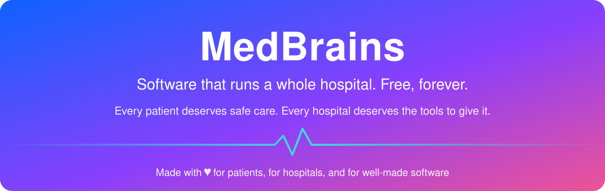
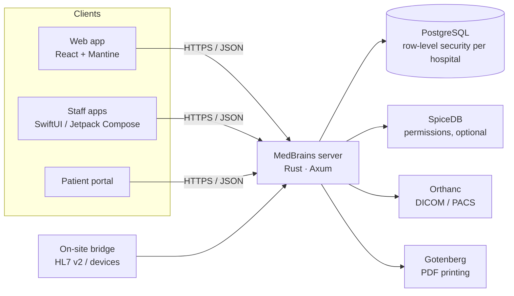

<div align="center">



[](#why-is-it-free)
[](#why-is-it-free)
[](#who-its-for)
[](#medbrains-os-a-hospital-in-a-box)
[](#credits-and-contact)
[](https://www.medbrains.in)

# MedBrains

**Software that runs a whole hospital: registration, OPD, wards, pharmacy, lab, radiology, billing.**

**It is free. No licence fee, no per-user fee, ever.**

**Batteries included:** the hospital software, its own operating system, built-in security, control of every machine, and compliance with each country's health rules. One install, nothing else to buy.

*Every patient deserves safe care, and every hospital, big or small, rich or poor, deserves the tools to give it. Built with love for patients, for hospitals, and for well-made software, so cost never stands between them.*

[](./LICENSE)
[](https://github.com/medbrains/medbrains/actions/workflows/ci.yml)
[](https://sonarcloud.io/summary/new_code?id=medbrains_medbrains)
[](https://github.com/medbrains/medbrains/actions/workflows/security.yml)
[](./SECURITY.md)
[](#release-status)
[](#why-rust)
[](./CONTRIBUTING.md)

[](#readiness)
[](#readiness)
[](#readiness)

[Website](https://www.medbrains.in) · [Features](#features) · [Releases](#release-status) · [Quick start](#quick-start) · [MedBrains OS](#medbrains-os-a-hospital-in-a-box) · [Roadmap](#roadmap) · [Sponsor](#sponsor-the-work) · [Contribute](#contributing)

</div>

<!-- TODO: add screenshot — main dashboard (docs/screenshots/dashboard.png) -->

---

## In one minute

- **For doctors and nurses:** register a patient, see the OPD queue, write notes and prescriptions, admit to a ward, give medicines with barcode checks, order labs and scans. One patient record across every department.
- **For hospital owners:** the software costs nothing to use, on as many computers, staff and branches as you like. You can run it on your own server, and your data stays yours.
- **For IT heads:** one Rust server, one PostgreSQL database, a web app, and staff apps for iPhone and Android. The code is public, so you can check every line.

## Release status

**MedBrains is in beta.** The first release, **v3.33.0**, is being prepared. It will appear on the
[Releases page](https://github.com/medbrains/medbrains/releases) with:

- the server for Linux (x86-64 and arm64)
- the desktop app for Windows and Mac
- the Android apps
- MedBrains OS disk images (see below)

Until then, build from source with the [quick start](#quick-start). Beta means the features listed
below work end to end, but please test with your own sample data before you put real patients on it,
and tell us what breaks.

## Readiness

Measured from the checklist in [`medbrains/docs/readiness.json`](medbrains/docs/readiness.json); an item counts only when merged with evidence.
Done counts in full and partial counts half, by each item's weight. `scripts/readiness.py` writes the badges and this table, and CI refuses an item without evidence or a stale table.

<!-- readiness:start -->
| Meter | Measured | Done | Partial | Not started |
|---|---|---|---|---|
| OS strength | **45%** | 9 | 0 | 9 |
| Paperless | **38%** | 4 | 1 | 7 |
| AI clinical flows | **38%** | 4 | 0 | 7 |

<details><summary>OS strength: 45%</summary>

| Item | Weight | State | Evidence |
|---|---|---|---|
| A bootable OS image built from source, checked by tests that boot it | 2 | Done | #5211, #5219, #5315, `medbrains/os/qemu-run.sh` |
| Default-deny firewall, authenticated time and first Linux hardening | 2 | Done | #5217 |
| Data disk encrypted, with every key accounted for | 3 | Done | #5230, `medbrains/os/tests/disk-setup.sh` |
| Signed A/B updates with trial boots and rollback; tampered and rolled-back updates refused | 3 | Done | #5279, `medbrains/os/tests/make-update-bundles.py` |
| Built-in identity provider (Kanidm); the first administrator enrols an authenticator at setup | 2 | Done | #5242, #5316, #5317, `medbrains/os/tests/kanidm-attacks.py` |
| A machine joins the main machine only by approval, over encrypted links | 2 | Done | #5226, `medbrains/os/tests/two-machines.sh` |
| Memory-safe front proxy (Pingora) in place of Caddy | 1 | Done | #5234, `medbrains/os/tests/front-attacks.py` |
| Append-only, hash-chained audit log of every change and record opened | 2 | Done | #4771, `medbrains/crates/medbrains-db-migrations/src/migrations/1082_audit_append_only.sql` |
| Backups sealed to an offline key, with a restore drill that proves they restore | 2 | Done | #5066, #5132, `medbrains/deploy/standalone/medbrains-restore-drill` |
| Wipe an OS machine's data disk, restore it and verify (ransomware test) | 2 | Not started | open: medbrains/docs/architecture/OS-THREATS.md row 3 |
| Sealed, read-only system partition (dm-verity) | 3 | Not started | open: #5451 |
| Kernel, service sandbox and AppArmor hardening, scored against CIS | 3 | Not started | open: #5449, #5453 |
| Release signing keys kept offline before the update feed opens | 3 | Not started | open: #5498 |
| Secure Boot with our own key and a signed boot image | 3 | Not started | open: medbrains/docs/architecture/OS-THREATS.md H2 |
| Room to grow on the system partition (8 MB left today) | 1 | Not started | open: #5519 |
| Release shipped as an installer ISO, VM and cloud disks | 2 | Not started | open: #5525 |
| Tests passed on real hardware, not only virtual machines | 3 | Not started | - |
| External penetration test report | 3 | Not started | open: medbrains/docs/architecture/OS-THREATS.md row 10 |

</details>

<details><summary>Paperless: 38%</summary>

| Item | Weight | State | Evidence |
|---|---|---|---|
| One case sheet per visit: written, signed and filed to the medical record | 3 | Done | #4715, #4717, #4718 |
| Medical records custodian: opens every chart, each opening logged | 2 | Done | #4719 |
| Signed prints carry a QR that lets an outsider check the record is unchanged; signing needs a fresh step-up | 3 | Done | #5241 |
| A meter of how paperless the hospital is, by department and day | 1 | Done | #5269, `medbrains/crates/medbrains-analytics/src/paperless.rs`, `medbrains/crates/medbrains-db-migrations/src/migrations/1424_paperless_meter.sql` |
| Every clinical record type signable by its author (21 types); partial because signing keys still sit on the server | 3 | Partial | #5259, `medbrains/crates/medbrains-documents/src/signable.rs` |
| Each doctor signs with their own hardware key (badge or FIDO2); the server cannot sign as them | 3 | Not started | open: RFCs/modules/RFC-MODULE-paperless-records.md 4.1 |
| Legal electronic signatures (remote DSC, eSign) through providers | 3 | Not started | open: RFCs/modules/RFC-MODULE-paperless-records.md 4.2 |
| Patient e-consent with capacity, witness and separate purposes | 2 | Not started | open: RFCs/modules/RFC-MODULE-paperless-records.md 4.3 |
| One-click court certificate from the seal chain and audit log | 1 | Not started | open: RFCs/modules/RFC-MODULE-paperless-records.md 4.4 |
| Transfer to another hospital with signatures kept and checkable | 2 | Not started | open: RFCs/modules/RFC-MODULE-paperless-records.md 4.5 |
| Downtime mode: a read-only snapshot and offline entry when the server is down | 2 | Not started | - |
| Connector that runs beside another hospital system (HL7 and FHIR in) | 3 | Not started | open: RFCs/modules/RFC-MODULE-paperless-records.md 8.5 |

</details>

<details><summary>AI clinical flows: 38%</summary>

| Item | Weight | State | Evidence |
|---|---|---|---|
| Doctor records or uploads dictation; it becomes note sections and medicines, each reviewed before saving | 3 | Done | #5258, `medbrains/apps/web/src/components/Clinical/dictation/DictationPanel.test.tsx` |
| Every model call goes through one pseudonymising redaction layer | 2 | Done | #5030, `medbrains/crates/medbrains-ai/src/redaction.rs` |
| Every AI answer is labelled, and reaches a record only when a clinician accepts it (audited) | 2 | Done | #4907, #5258 |
| Dictated medicines become a prescription only through the allergy, interaction and dose checks | 2 | Done | #5258, #5244, `medbrains/apps/web/src/components/Clinical/dictation/dictated-rx-store.ts` |
| Local speech and language models shipped as an OS service on the appliance | 3 | Not started | - |
| Kernel AI interface with permissions, consent and audit on every call | 3 | Not started | open: medbrains/RFCs/RFC-HOSPITAL-OS.md 8h |
| MCP server so outside assistants work under the same permissions | 2 | Not started | open: medbrains/RFCs/RFC-HOSPITAL-OS.md 8f |
| Voice capture in the native iOS and Android apps | 2 | Not started | - |
| Speech in local languages and mixed-language dictation | 2 | Not started | - |
| Patient consent captured before a consultation is recorded | 2 | Not started | - |
| Dictation that works with no network | 1 | Not started | - |

</details>
<!-- readiness:end -->

## Why is it free?

People reasonably ask what the catch is. Here is the whole answer:

- **The software is free forever** under the [GNU AGPL-3.0](./LICENSE). Any hospital, clinic or pharmacy can use it, change it and run it, without asking us. If you change it and let people use it over a network, you share your changes under the same licence.
- **Selling it or building a closed product on it?** Take a [commercial licence](./COMMERCIAL-LICENSE.md) instead.
- **The code is public.** Anyone can read how it checks a drug interaction or who can see a record.
- **Every release's source stays public, and that is a pledge.** The source of every MedBrains release, including the ones subscribers and commercial licensees run, is published in this repository and never put behind a login, a paywall or a customer portal. No contract we sign, subscription, support or commercial, will ever contain a term against sharing that source. We sell updates, support and warranty, never access to the code.
- **No licence fees, no per-user fees, no selling your data.** We never see your data unless you ask us to host it.
- **How the team earns:** only from *optional* setup, training, hosting and support for hospitals that want help ([pricing](https://www.medbrains.in/pricing)). If you can run it yourself, you owe us nothing.

**Why we are doing this:** good hospital software is expensive and locks hospitals in. The places that need it most (small, rural and charitable hospitals) can least afford it. Patient-safety rules such as drug checks, consent and controlled-drug registers should be open to inspection, and free for anyone to run. MedBrains aims to be a [Digital Public Good](#digital-public-good) for health.

## Who it's for

| | |
|---|---|
| **Small and rural hospitals** | Run the full hospital on one small server, with no licence budget. |
| **Charitable and trust hospitals** | Money goes to patients, not software fees. |
| **Multi-specialty hospitals** | Many departments, roles and branches, with fine-grained access control. |
| **Developers and health-tech teams** | A real, tested hospital codebase to learn from, extend, or build on. |

## Features

These features are built end to end: database, server and screen. Things that are only partly done are listed under [Roadmap](#roadmap) instead.

**Registration and front office**
- Patient registration with automatic UHID, photo, contacts, insurance and allergies
- Duplicate-patient check while you type (fuzzy name match), plus merge and unmerge
- OPD token queue (call, start, complete, no-show) and token display boards

**OPD (outpatient)**
- Case sheet / clinical notes with sign, countersign and revision history
- Prescriptions with drug-interaction checks
- Diagnosis search with ICD-10 and ICD-11 codes
- Duplicate-investigation warning, referrals, certificates and consents

**IPD (wards)**
- Admission, live bed board, discharge summary
- eMAR: medication rounds with barcode verification at the bedside
- Nursing charts: vitals, intake/output, pain, wounds, fall risk, shift handover, code blue

**Emergency**
- ER visits and triage
- Medico-legal cases (MLC) with injury records and police intimation

**Operation theatre**
- OT bookings and schedule, WHO-style safety checklist, anaesthesia record

**Pharmacy**
- Prescription queue and dispensing, stock with batches and expiry (first-expiry-first-out)
- NDPS register for narcotics; Schedule H / H1 / X rules enforced on the server
- Drug-interaction check; allergy conflicts block dispensing on the server
- Counter sales (OTC) and returns

**Laboratory**
- Orders, results, verification and amendments
- Critical-value alerts sent to the doctor's inbox
- Quality control (Westgard rules)

**Radiology**
- Orders and reports
- PACS link with [Orthanc](https://www.orthanc-server.com/) (open source): worklist and studies matched to orders

**Blood bank**
- Donors and eligibility, crossmatch with issue checks, transfusions and reaction reporting

**Billing and insurance**
- Invoices, packages, credit notes, refunds, GST returns
- Insurance / TPA claims and rate cards

**Stores, HR and payroll**
- Procurement and indents
- Staff, duty roster, attendance and duty hours
- Basic payroll: salary structures, payroll runs, payslips

**Reports and admin**
- Dashboards, report catalogue with CSV export, NABH quality indicators
- Self-service hospital onboarding
- Roles and permissions down to single actions, plus field-level access (hide a field from a role)
- Tamper-evident audit log (hash-chained, append-only) with export

**Patient portal**
- Patients can see their records, request refills, use teleconsultation, and manage privacy requests

**Staff mobile apps (native iPhone and Android)**
- Reception: register and find patients, OPD queue
- Doctor: consultation notes, IPD rounds
- Nurse: MAR schedule, give doses with barcode check, transfusion monitoring, code blue, shift handover

## Customise it for your hospital

You don't need a developer for most of this:

- **Roles and permissions.** Create your own roles and choose exactly what each one can see and do.
- **Field-level access.** Hide sensitive fields (for example, HIV status) from roles that don't need them.
- **Departments, wards, beds, services and prices.** All set up from the admin screens.
- **Your language.** The interface text is translatable.

Developers can go further, because the code is open: add a module, change a workflow, or connect your own devices.

## Standards and compliance

Only what the code does today. MedBrains is **built to** these standards; it does not claim a certification it has not been given.

| Standard | Status |
|---|---|
| **ICD-10 / ICD-11** | Diagnosis coding. ICD-11 uses the WHO ICD API container. |
| **HL7 v2** | MLLP listener on the on-site bridge, for lab analysers and devices. |
| **DICOM** | Through Orthanc: worklist and studies linked to radiology orders. |
| **HL7 FHIR R4** | Read API for `Patient` (including `$everything`), `Encounter`, `Observation`, `DiagnosticReport` and `Composition`. Write and search are on the roadmap. |
| **ABDM** | ABHA (M1), health-record linking as a provider (M2, HIP), consent requests as a user of records (M3, HIU), Scan & Share and NHCX claims are in the code. They need your ABDM credentials, and MedBrains has not yet been through ABDM's certification. |
| **LOINC** | Lab tests carry a LOINC code field. The LOINC dataset is not bundled. |
| **SNOMED CT** | Optional. A loader script imports RF2 files you obtain yourself. SNOMED needs a licence: free through your country's national release centre where one exists, otherwise an affiliate licence. No SNOMED content ships with MedBrains. |

**Privacy (DPDP Act, 2023):** MedBrains records patient consent, and tracks access, correction, erasure, nominee and grievance requests with due dates. It keeps a full audit trail, separates hospitals with database row-level security, and lets you restrict fields by role. Erasure requests are decided by a person, because medical records have legal retention periods. The software helps you comply; your hospital is still the data fiduciary.

## Your data is yours

- **Open database.** All data sits in a normal PostgreSQL database that you control. The schema is in the repo.
- **Patient download.** A patient can download their record as a FHIR R4 Bundle (JSON) from the portal.
- **CSV exports** for reports, analytics and the audit log.
- **Backups** with standard PostgreSQL tools; scripts and a restore guide are in [`medbrains/docs/ops/BACKUP-RESTORE.md`](medbrains/docs/ops/BACKUP-RESTORE.md).
- **No lock-in.** If you stop using MedBrains, your database is still yours, in an open format.

## Quick start

> Today the quick start is for developers. A single-command Docker setup for hospitals is on the [roadmap](#roadmap).

**You need:** macOS or Linux, Docker, Rust 1.85+ (`rustup`), Node 24 and pnpm 10. The first Rust build is large and takes a while; 16 GB RAM and about 60 GB of free disk are recommended.

```bash
git clone https://github.com/medbrains/medbrains.git
cd medbrains/medbrains
cp .env.example .env
make db              # PostgreSQL, SpiceDB, Gotenberg, mail server (Docker)
make dev-db-roles    # creates the app's database roles
make dev-backend     # builds and runs the server on :3000; migrations run automatically
```

In a second terminal:

```bash
cd medbrains/medbrains
pnpm install
pnpm dev:web         # web app on http://localhost:5173
```

**Sign in:** hospital code `DEFAULT`, username `admin`. In development, the password is shown on the sign-in page under "Dev credentials". Set `MEDBRAINS_SEED_ADMIN_PASSWORD` before the first start to choose your own. In production, the server refuses to start without it and asks for a new password at first sign-in. Set `MEDBRAINS_SEED_DEMO_DATA=true` for sample data.

To install at a hospital, see the on-site deployment kits in [`medbrains/deploy/`](medbrains/deploy/).

## Architecture

Full design: [MedBrains OS architecture](medbrains/docs/architecture/HOSPITAL-OS-ARCHITECTURE.md).



- **One server, many hospitals.** Each hospital's rows are kept apart by PostgreSQL row-level security, set per request.
- **SQL checked at compile time** with SQLx. A query that doesn't match the schema doesn't build.
- **Split into about 119 Rust crates** by department, so one department's change doesn't touch the rest.
- **Open dependencies.** PostgreSQL, Orthanc, SpiceDB and Gotenberg are all open source. Paid services such as SMS, email, payment gateways and AI are optional add-ons, and file storage can be S3 or local disk.

## MedBrains OS: a hospital in a box

MedBrains is also its own operating system: a small, open OS on Debian Linux that runs every
machine in the hospital, so a hospital without an IT team can plug in and start. It is cheap by
design (only the server needs real hardware), simple out of the box (setup is a few plain screens,
no command line), and built so a local IT firm can install and look after it.

**One image per processor type** (x86-64 and arm64). The same OS runs on every machine; you choose
its role on the first-boot screen. One server manages everything. Every other machine is a node on
the smallest hardware that does its job and holds no system of record, so it can be replaced in
minutes. Keep a standby server: one server is a single point of failure.

| Role | What it does | Patient data on it |
|---|---|---|
| Server | database, sign-in (Kanidm, with an authenticator app), certificates, the Nodes screen | yes, on an encrypted disk where there is a TPM |
| Workstation | staff sign in and work | none, or only what offline mode needs |
| Display | queue board or TV (joins today; the board is not built) | none |
| Ward backup | keeps a ward running if the server or network fails (planned) | yes, encrypted |

**Joining a machine:** the new machine finds the server (local discovery or a typed address) and
shows a code; an administrator approves it on the server, and the approval is audited. A second
code lets the new machine check that it found the real server. Removing a machine ends its access at
once (an offline machine learns this when it reconnects). Changing a role is a deliberate reset.

**Not locked to one app.** The OS opens to a desktop with a dock and a launcher, and each app runs in
its own sandboxed view. MedBrains is one of them.

**Secure by default:** firewall and kernel hardening before the first boot, the data disk sealed to
the TPM where there is one, a single Rust front (Pingora) for HTTPS, and no Docker: every service
runs directly on Linux under systemd.

**Hardware (recommendations, not tested kits).** Worked out from virtual-machine measurements. None
of this has run on a real Raspberry Pi or PC yet, and sizing a hospital server for a large site waits
on a load test. The same table, with a diagram, is on [medbrains.in/os](https://www.medbrains.in/os).

| Machine | Minimum | Recommended | Why |
|---|---|---|---|
| Server, small clinic | 4 cores, 8 GB RAM, 64 GB SSD | Raspberry Pi 5 8 GB with an NVMe SSD | the whole machine uses about 1.2 GB with a user signed in; the database, sign-in and server all run here |
| Server, hospital | 8 cores, 16 GB RAM, 512 GB NVMe SSD | 16–32 GB RAM, mirrored SSDs, a TPM, a UPS, plus a standby server | the database grows with patients; the server program itself is 88 MB |
| Workstation | 2 cores, 4 GB RAM, 32 GB storage | any small PC or arm64 board that drives the screen | the node desktop uses about 300 MB, plus about 320 MB for an open page |
| Display or TV board | 2 cores, 2–4 GB RAM | a Pi-class board | holds no patient data |
| Optional | a GPU or AI chip | used when present, never required | on-box AI, imaging hints |

**Measured sizes** (one run each, in virtual machines; details in
[`medbrains/os/README.md`](medbrains/os/README.md#measured)):

| What | Size |
|---|---|
| Download (compressed with zstd) | 478 MB |
| Installed system | 1,158 MB (the ≤ 1 GB target is not met yet) |
| Data disk after first boot | 216 MB |
| Web app first page | about 308 KB with zstd, 328 KB with gzip |

**Measured so far** (virtual machines on a laptop, one run each): a workstation node uses about
300 MB of memory at its desktop; removing a machine ends its access within about 2 s. Hardware
tiers in the plan: [RFC-HOSPITAL-OS §8a and §8p](medbrains/RFCs/RFC-HOSPITAL-OS.md).

**Status, and what is not done yet:** the image builds and boots in virtual machines (QEMU and UTM),
including the TPM-sealed disk on x86-64. Not done: signed A/B updates with rollback (in review); the
display board and the ward backup role; verified boot and machine keys in the TPM; nightly backups on
the OS. It has not run on real hardware or a Raspberry Pi, had no outside penetration test, and no
hospital runs it in production yet.

How to build and boot it: [`medbrains/os/README.md`](medbrains/os/README.md). The plan:
[RFC-HOSPITAL-OS](medbrains/RFCs/RFC-HOSPITAL-OS.md).

## Why Rust

- **Memory safety.** Rust rules out whole classes of crashes and security holes. `unsafe` code is forbidden in this project.
- **No surprise crashes.** Lints forbid `unwrap`, `expect`, `panic` and `todo`, so every error is handled.
- **Small and fast.** A single compiled server runs comfortably on modest hardware.

Measured numbers we have so far: across 16,779 requests from our automated smoke tests, the median API response was **7 ms**, p95 **54 ms** and p99 **97 ms**. These come from single-user test runs on a developer machine, not a load test. Load-test results will be published when we have them.

The test suite has about 1,500 Rust tests, 206 Playwright browser specs and 177 web unit-test files.

## MedBrains vs a typical commercial hospital system

| | MedBrains | Typical commercial system |
|---|---|---|
| Licence cost | Free | Upfront licence, often large |
| Per-user / per-bed fees | None | Common |
| Source code | Public, you can audit it | Closed |
| Your data | Open PostgreSQL, FHIR and CSV export | Often a vendor format; export may cost extra |
| Customisation | Change anything yourself, or hire anyone | Through the vendor only |
| Hosting | Your server, any cloud, or ours (optional) | Usually the vendor decides |
| Support | Community free; paid support optional | Bundled into the contract |

## Roadmap

**Partly built**
- **ABDM:** M1–M3, Scan & Share and NHCX claims are merged. They still need testing on the ABDM sandbox and certification.
- **MedBrains OS:** test on real hardware and build the Raspberry Pi image.
- **FHIR:** add search, write, and whole-hospital bulk `$export`.
- **LOINC:** load and map the LOINC dataset, beyond today's code field.
- **SNOMED CT:** connect the terminology client to the screens.
- **Inventory screens:** stores inventory is thin compared with procurement.
- **Payroll:** statutory PF / ESI filing.
- **Online payments:** only one payment gateway today. A provider-neutral layer is planned.
- **Native apps:** pharmacy, lab, radiology, OT and blood bank screens.
- **Allergy check on screen:** show the warning while prescribing, not only when dispensing.

**Planned**
- One-command Docker install for hospitals (server plus web in one compose file)
- Published load-test results
- Registration with the Digital Public Goods Alliance

## Digital Public Good

We are building MedBrains to meet the [Digital Public Goods Standard](https://digitalpublicgoods.net/standard/) and plan to apply for registration. It serves **SDG 3: Good Health and Well-being**, uses an open licence (AGPL-3.0), runs on an open stack, and documents how it handles privacy. See [GRANTS.md](./GRANTS.md) for how it maps to each criterion.

## Get help

- **Community (free):** [GitHub Issues](https://github.com/medbrains/medbrains/issues) for bugs, [Discussions](https://github.com/medbrains/medbrains/discussions) for questions and ideas.
- **For hospitals (paid, optional):** setup, data migration, staff training, hosting and support contracts. See [pricing](https://www.medbrains.in/pricing) or [book a demo](https://www.medbrains.in/#demo).
- **Install MedBrains for hospitals near you:** join the [partner programme](https://www.medbrains.in/partners).
- **Security issues:** please don't open a public issue. Follow [SECURITY.md](./SECURITY.md).

## Sponsor the work

Sponsorship keeps MedBrains free for hospitals that can't pay. You can sponsor:

- **A module.** Fund a feature from the roadmap, such as ABDM M2/M3, LOINC mapping or the one-command install.
- **A hospital.** Pay for setup and training at a rural or charitable hospital.
- **A language.** Fund translation into a regional language.
- **A security audit** or ABDM certification.

<!-- TODO: add sponsorship link (GitHub Sponsors / Open Collective) -->
See [medbrains.in/sponsors](https://www.medbrains.in/sponsors) for how sponsorship works, or write to hello@medbrains.in.

## Contributing

You don't have to write code to help. We need:

- **Clinicians, pharmacists, nurses and administrators** to tell us where a workflow or rule is wrong. This is the most valuable help of all.
- **Translators** for regional languages.
- **Developers.** Good places to start:
  - Show the allergy warning on the prescribing screen (the API already exists)
  - FHIR search and write endpoints
  - LOINC dataset import and mapping
  - Native pharmacy or lab screens (SwiftUI / Jetpack Compose)
  - Accessibility fixes (WCAG 2.2 AA)
  - Documentation and setup guides
- **Testers** to try it in a real department and report back.

Read [CONTRIBUTING.md](./CONTRIBUTING.md) to get started. Pull requests are merged after you sign the [contributor licence agreement](./CLA.md); until then, open an issue. Never put real patient data in an issue, commit or test.

## License

MedBrains is dual-licensed: the [GNU Affero General Public License, version 3 only](./LICENSE) (`AGPL-3.0-only`), free for everyone, or a [commercial licence](./COMMERCIAL-LICENSE.md) for those who cannot meet the AGPL's terms. See [NOTICE](./NOTICE). Versions released before 2026-11-12 were licensed under Apache 2.0. The client SDKs (`packages/sdk`, `sdks/python`) stay under Apache 2.0, so integrating with MedBrains never forces a licence on your code.

**Trademarks:** "MedBrains" and the MedBrains logo are trademarks (™) of Domnic Amalan S. Neither licence covers them. You may say you run MedBrains, redistribute it unchanged, and call a modified fork "based on MedBrains" under your own name. Product names, "official" or "certified" claims, "MedBrains Compatible", the logo in your marketing and domains need written permission. See the [trademark policy](./TRADEMARKS.md).

## Credits and contact

Created by **Domnic Amalan S** ([@DomnicAmalan](https://github.com/DomnicAmalan)), with thanks to everyone who contributes.

Built on the shoulders of open source: Rust, Axum, SQLx, PostgreSQL, React, Mantine, Orthanc, SpiceDB, Gotenberg, and many more.

Website: [medbrains.in](https://www.medbrains.in) · [Health blog](https://www.medbrains.in/blog) · [Partners](https://www.medbrains.in/partners) · [Sponsor](https://www.medbrains.in/sponsors)
