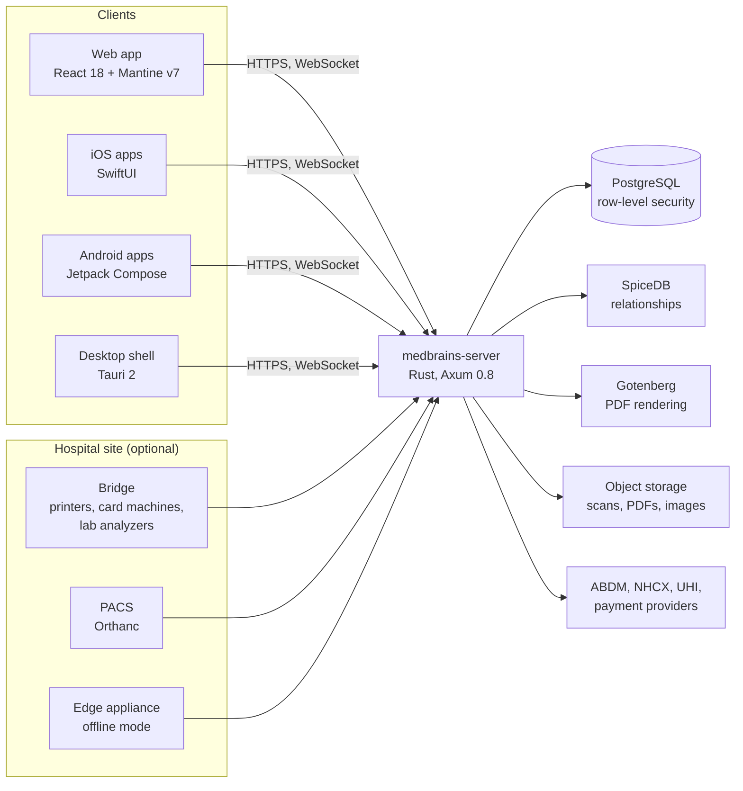

# MedBrains

A multi-tenant hospital information system, built for Indian hospitals first and designed to work in other countries.

[](#licensing)
[](#architecture)
[](./CODE_OF_CONDUCT.md)

MedBrains runs the day of a hospital: registration and queues, OPD and wards, lab, imaging, pharmacy, billing and payments, insurance claims, and the records and audits that accreditation and the law ask for. It is one system for many hospitals — each hospital is a tenant, isolated by PostgreSQL row-level security — with a web app for every desk and native apps for staff and patients. We build it in the open because the rules that keep patients safe (medication checks, consent, who may see a record) should be readable by the people who depend on them.

**Status:** in active development. Interfaces and schemas still change between releases. See the [roadmap](./ROADMAP.md).

---

## What it does

A summary of what is in the code today. Each area has more detail in the RFCs and in the [user guide](./medbrains/apps/docs).

### Clinical

- OPD with token queues, priority lanes, counters and waiting-room boards; walk-ins, appointments, referrals to a named colleague and back.
- One case sheet per visit or admission: every clinician's note is a dated, signed entry; a resident's note waits for countersignature; unsigned notes hold the medical-record packet.
- IPD and nursing: admissions, ward rounds, a bed board with holds and out-of-service reasons, the drug chart, and a discharge gate that waits for charges and decisions.
- Emergency with medico-legal cases (injuries recorded on a body map), operating theatre, ICU, dialysis (machine booking, dialyzer reuse limits), dental odontogram, eye OPD with spectacle prescriptions, home visits and health camps.
- Video consultations that are real visits: the doctor sees them in the queue and the bill counts them.
- AI-assisted drafts are always labelled as AI and only enter the record when a clinician accepts them. Patient identities are removed before anything goes to an outside model.

### Diagnostics

- Laboratory from order to verified report: collection, worklists, critical values, analyzer orders and ASTM results through an on-site bridge.
- Imaging through a PACS (Orthanc): worklist out, study back to its order; an on-site PACS kit with a nightly cloud copy. A PC-PNDT Form F opens with every pregnancy ultrasound and holds the report until it is complete.
- Blood bank, CSSD and infection control.

### Pharmacy

- Formulary with drug schedule (H, H1, X), NDPS register, LASA flags, allergy and interaction checks, FEFO batches and expiry.
- Counter billing, returns at their real price, day close, transfers between stores, supplier bills scanned into GRNs.
- Refills authorised by the doctor, prescription expiry, repeat-last-prescription.
- An online storefront for the hospital pharmacy, with home delivery by runner or courier and tracking for the patient.

### Billing and payments

- Bills for OPD, IPD and pharmacy, with revisit windows, each doctor's own fee, and insurer/patient splits on one screen.
- Collect anywhere: one Collect drawer, opened from a due chip at any desk, that posts the money exactly once.
- A provider-neutral payments layer: online checkout through Razorpay, Cashfree, PhonePe or PayU; card machines (Pine Labs, Ezetap, Razorpay POS) through the site bridge, with a simulator; self-confirming UPI QR; payment links that allow part payment online and the rest in cash; a customer display at the counter.
- Doctor payouts for visiting and day doctors: agreements, sharing rules, approval, and payment with TDS.

### Interoperability

- ABDM: ABHA verification and linking, M1–M3 (linking records to ABHA and sharing them with consent; requesting records from other hospitals), Scan & Share at the counter, and a dashboard of what ABDM earns and where it fails. **Built to integrate and waiting on go-live keys — not certified.**
- NHCX insurance claims: eligibility, pre-auth with payer queries, final claims with summary, bill and lab PDFs, and payment posting. Built to integrate; not certified.
- UHI provider: teleconsult booking, ambulance and blood availability for patient apps.
- HL7 FHIR R4: case sheets as Compositions, lab and imaging reports as DiagnosticReport, and a patient's own record export.
- SNOMED CT terminology service (import, search, hierarchy), ICD-10/11 through the WHO ICD-API, LOINC for lab tests.
- Signed webhooks to partner systems, a request budget per API key, and a published OpenAPI description.

### Patient and staff apps

- **Web app** for every desk and role, in light and dark themes, built to WCAG 2.2 AA.
- **Native staff app** (SwiftUI on iOS, Jetpack Compose on Android): front office, doctor and nurse modules, ABHA at reception, Scan & Share, sticky notes; bound to a hospital by a signed QR code.
- **Native patient app** (iOS and Android): refills, pharmacy delivery and tracking, privacy controls.
- Patient portal, bedside portal, waiting-room displays that pair themselves, and a desktop shell (Tauri).
- Alerts with three sounds (calm, attention, urgent) across web and native.

The React Native apps under `medbrains/apps/mobile-*` and `medbrains/apps/tv` are being replaced by the native apps and are kept for reference only.

### Administration and compliance

- Self-service onboarding: a 30-day trial sign-up, or set up a hospital from one Excel workbook.
- A custom domain per hospital, proved by DNS before it takes effect.
- HR, rosters and attendance with a per-campus geofence; assets, facilities, diet kitchen, housekeeping.
- Management dashboards that read each department against its usual day; a widget menu filtered by permission.
- Marketing CRM: website enquiries arrive as leads, with campaign attribution.
- DPDP: privacy notice at registration, consent recorded purpose by purpose, a rights desk with its 90-day clock, a register of data processors.
- NABH checklists assessed on screen and scored by the server; incidents and CAPA; printed documents read what the hospital recorded and carry a signature or a DRAFT mark.

### Platform and security

- Multi-tenant PostgreSQL with transaction-scoped row-level security on every tenant table.
- Over 1,100 permissions, defined in Rust and generated into the TypeScript catalogue; relationship-based checks on patient records (SpiceDB); break-the-glass access that alerts reviewers at once.
- Authorisation has three outcomes — allow, deny, unknown — and a fault never shows up as "no data".
- Append-only audit trail; refusals and failed sign-ins are audited; high-volume audit tables are partitioned by month.
- A module licence gate per hospital that closes, rather than opens, on a fault.
- Print delivery to real printers (ZPL, ESC/POS, PDF) through the site bridge; an edge appliance for offline running.

## Architecture



- **Backend:** Rust (edition 2024, MSRV 1.85) on Axum 0.8 and Tokio, split into about 140 crates under `medbrains/crates` — one per module or concern, assembled by `medbrains-server`. SQL through SQLx; errors with `thiserror`; structured logs with `tracing`. Ed25519 JWTs, Argon2id passwords. `unsafe` is forbidden and clippy is strict.
- **Database:** PostgreSQL 16 or newer (the dev stack runs 17) is the single source of truth, including configuration, sequences and bed state. Migrations are embedded in the binary.
- **Web:** React 18, strict TypeScript, Vite, Mantine v7, SCSS modules, React Router, TanStack Query, Zustand, React Hook Form and Zod. The look follows the IBM Carbon-based rules in [`medbrains/docs/DESIGN-RULES.md`](./medbrains/docs/DESIGN-RULES.md).
- **Native:** Swift 6 + SwiftUI and Kotlin + Jetpack Compose (Material 3), sharing offline and sync logic through a Rust core via UniFFI. See [`RFCs/RFC-NATIVE-MOBILE.md`](./RFCs/RFC-NATIVE-MOBILE.md).
- **Website:** Astro site and blog in `website/`.
- **Monorepo:** pnpm workspaces and Turborepo; Biome for lint and format.

## Repository layout

```
.
├── README.md, ROADMAP.md, CONTRIBUTING.md, SECURITY.md, …
├── Makefile                 # forwards every target to medbrains/Makefile
├── RFCs/                    # design specs: authorisation, native apps, modules, …
├── website/                 # Astro marketing site and blog
└── medbrains/
    ├── Cargo.toml           # Rust workspace
    ├── Makefile             # dev, build, checks, tests (`make help`)
    ├── docker-compose.yml   # Postgres, SpiceDB, Gotenberg, Orthanc, mail, ICD-API
    ├── crates/              # backend crates; medbrains-server is the binary
    ├── apps/
    │   ├── web/             # main web app
    │   ├── ios/             # SwiftUI: MedBrainsStaff, MedBrainsPatient, shared packages
    │   ├── android/         # Compose: app-staff, app-patient, core/kit/ui modules
    │   ├── desktop/         # Tauri shell around the web app
    │   ├── docs/            # in-app user guide (Docusaurus)
    │   ├── edge/            # offline edge appliance
    │   └── mobile-*, tv/    # React Native — outgoing, reference only
    ├── packages/            # shared TS packages: types, api, stores, schemas, design-system, …
    ├── deploy/              # standalone server, on-prem, PACS and Helm kits
    ├── infra/               # Terraform and Packer
    ├── docs/                # design rules, accessibility, ops, compliance, SOPs
    └── RFCs/                # more RFCs: data, onboarding, notifications, …
```

## Quick start

You need Rust (stable — `rust-toolchain.toml` pins the components), Node 24+, pnpm 10+ and Docker.

```bash
git clone https://github.com/medbrains/medbrains.git
cd MedBrains/medbrains

cp .env.example .env     # local defaults; read the comments
pnpm install

make doctor              # looks for common dev traps; changes nothing
make db                  # Postgres, SpiceDB, Gotenberg and mail in Docker
make dev-db-roles        # once per dev database: passwords for the app and worker roles
make dev-backend         # the API server; migrations run on start
make dev-frontend        # in a second terminal: the web app on http://localhost:5173
```

A fresh database is seeded with a development login, `admin` / `admin123`. When `MEDBRAINS_ENV=production` the seed refuses that default and needs `MEDBRAINS_SEED_ADMIN_PASSWORD`.

`make dev` starts the whole stack behind a local HTTPS proxy at `https://medbrains.localhost`, with a local WHO ICD-11 service. `make help` lists every target.

A backend build is large (well over a thousand dependencies). Point `CARGO_TARGET_DIR` at a disk with room to spare, and do not run two cargo builds at once on a laptop — `medbrains/scripts/build_guard.sh` tells you whether the machine is free.

Native apps:

```bash
make native-ios          # generate the Xcode project and build MedBrainsStaff for the simulator
make native-android      # build the Android staff app and run the kit unit tests
```

## Tests and checks

| Command | What it runs |
|---|---|
| `make test-unit` | Rust unit tests that need no database |
| `make test-rust` | all Rust tests (needs the dev database) |
| `make test-ts` | TypeScript unit tests (Vitest) |
| `make test-e2e` | Playwright scenario tests against a running app |
| `make smoke-test` | API smoke tests against a running backend |
| `make native-ios-test` | Swift package tests |
| `make lint` | Biome lint and format check |
| `make check-all` | the static gates: API contract, permissions, row-level security, soft-delete filters, UI seam, secrets and more |
| `make gate` | the pre-merge gate: Biome, typecheck, `check-all`, targeted clippy and tests |

## Documentation

- [Roadmap](./ROADMAP.md) — what is in progress and what is planned.
- [Contributing](./CONTRIBUTING.md) — setup, branches, gates, the CLA.
- [`CLAUDE.md`](./CLAUDE.md) — the full coding standards and module build workflow, written for people and coding agents alike.
- [`RFCs/RFC-AUTHZ-2026-001-Design-and-Grammar.md`](./RFCs/RFC-AUTHZ-2026-001-Design-and-Grammar.md) — how authorisation works.
- [`RFCs/RFC-NATIVE-MOBILE.md`](./RFCs/RFC-NATIVE-MOBILE.md) — the native apps.
- [`medbrains/docs/DESIGN-RULES.md`](./medbrains/docs/DESIGN-RULES.md) and [`medbrains/docs/WCAG-2.2-RULES.md`](./medbrains/docs/WCAG-2.2-RULES.md) — design and accessibility rules.
- [`medbrains/docs/ops/`](./medbrains/docs/ops) — database roles, backup, restore, monitoring.
- [`medbrains/deploy/standalone/README.md`](./medbrains/deploy/standalone/README.md) — deploying on one server.
- [`medbrains/apps/docs`](./medbrains/apps/docs) — the user guide shipped inside the app at `/help`.

## Licensing

MedBrains is offered under **the GNU AGPL-3.0 or a commercial licence**, at your choice.

- Under the AGPL-3.0 you may use, change and host MedBrains free of charge. If you let others use a modified version over a network, you must offer them its source under the same licence.
- A commercial licence is for those who cannot meet that condition — a closed product, or a hosted service whose changes stay private — and can include support. See [COMMERCIAL-LICENSE.md](./COMMERCIAL-LICENSE.md).

Contributors sign the [Contributor Licence Agreement](./CLA.md) so that their work can be offered under both licences. You keep your copyright.

The MedBrains name and logo are trademarks and are not covered by the code licence. A fork must not present itself as MedBrains.

## Security

MedBrains holds patient data. Report vulnerabilities privately, as described in [SECURITY.md](./SECURITY.md) — never in a public issue.

Never put real patient data in an issue, a commit, a test or a fixture.

## Community

- Read [CONTRIBUTING.md](./CONTRIBUTING.md) and the [Code of Conduct](./CODE_OF_CONDUCT.md).
- Bugs and feature requests go in [issues](https://github.com/medbrains/medbrains/issues), using the templates.
- Clinicians, pharmacists and hospital administrators: telling us where a workflow or a rule is wrong is worth as much as code.
- General questions: hello@medbrains.in.
- Funders and public-health programmes: see [GRANTS.md](./GRANTS.md).
