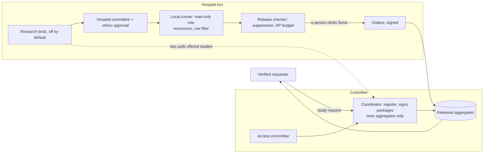

# RFC: Federated research and benchmarking network

**Status:** Design, for legal review before any code (owner decision 2026-11-25) · **Decision:**
`docs/decisions/2026-11-25-federated-research-network.md` · **Builds on:** `RFC-HOSPITAL-OS.md`
(each hospital runs its own box; §8r: the hospital holds the keys), `RFC-ONE-RELEASE-LEGO-BRICKS.md`
(bricks), `docs/OS-PRINCIPLES.md`, `RFCs/RFC-AUTHZ-2026-001-Design-and-Grammar.md` (data classes),
the quality benchmark RFC in draft PR #6020 (`RFC-MODULE-quality-benchmark.md`)

> Nothing here is legal advice. Each legal statement is research, with its source, its date and
> whether we read the primary text (**V**) or could not (**U**). Section 17 lists what a health-data
> lawyer must answer. Legal review comes before code.

## 1. The rule

**The data never leaves the hospital, and the hospital earns from research.**

A study's question travels to each hospital's own server, runs there on that hospital's data, and
only checked aggregates come back. There is no central copy of any patient's record, anywhere.
Verifying a requester decides **who may ask**; it never decides whether rows leave. Rows never do.

India is the first country pack, not the only one. The design takes the strictest common shape of
India's DPDP Act, the EU's GDPR and EHDS, and US HIPAA, so a new country is a pack of rules, not a
redesign.

### Who benefits, under the three-reasons rule

| Who | What they get | Reason |
|---|---|---|
| The hospital | a share of the fixed fee for each study it joins; its own quality numbers against peers, free | generates revenue; safe and legal (it keeps custody, its ethics committee decides) |
| Patients | research on Indian patients and Indian disease without their record being copied; a visible, revocable choice | safe and legal |
| Medical colleges, postgraduate students, faculty, institutes | multi-hospital answers for theses and studies, without building a registry | (their reason) |
| Public health programmes | district trends, outbreak and resistance signals, sooner | safe and legal (public health) |
| Industry requesters (pharma, insurers) | narrow, pre-approved aggregate questions only (section 3) | revenue for hospitals, under the tightest controls |
| MedBrains | runs the coordinator for the custodian; a network made of hospitals' trust, which public code cannot copy | revenue, under terms kept private |

Commercial terms: private, owner. Fees are fixed per study, never priced per record (section 5).

## 2. What is fixed (owner, 2026-11-25)

1. **Federated only.** Aggregates (counts, rates, distributions, model coefficients) come back;
   patient rows never leave. No central data lake.
2. **Small-cell suppression on every released number**, with secondary suppression, and noise
   (differential privacy) where queries repeat or are fine-grained (section 10).
3. **Linkage only by keyed tokens** (HMAC under a hospital-held secret), under an approved
   protocol; linked data is personal data. Never for industry requesters.
4. **Excluded by default, enforced in code:** HIV, psychiatry, PCPNDT, MTP, MLC/POCSO, NDPS,
   genetics.
5. **Every study has a protocol, a named principal investigator, and approval from a registered
   ethics committee**; the hospital approves each study it joins; patient consent goes through the
   ABDM consent manager where the purpose needs it.
6. **The hospital earns a share** of the study fee.
7. **A hard firewall:** no requester or funder influences any clinical alert, suggestion, order
   set, default or ranking (section 11). Results by individual prescriber or clinician are refused.
8. **Milestone 1 has no paying requester:** the benchmark network (section 15).

## 3. Who touches what

| Requester | May receive | Never |
|---|---|---|
| Medical colleges, researchers | approved study results (aggregates); cohort analysis in place (section 13) | rows or identities |
| Public health programmes | district-level trends; outbreak and antimicrobial-resistance signals | anything about a named person |
| Pharma companies | trial feasibility counts; outcome and drug-safety studies under an approved protocol; recruitment **only through the patient's own doctor**, after the patient consents | doctor-level prescribing, patient lists, marketing segments; who the patients are |
| Insurers | coarse population figures: costs, length of stay, incidence by age band and region; aggregate fraud patterns only for a government scheme, with the scheme as the requester | a person-level score; anything usable to price or refuse a person |
| Hospitals | their own data in full; others only as benchmark percentiles | another hospital's values |
| MedBrains staff | run the coordinator (aggregates, signatures, logs) | any patient data, any hospital key |

**Enforced in code, not only in contracts:**

- Each requester has a **class** (`academic`, `public_health`, `industry_pharma`, `industry_insurer`,
  `hospital`) fixed at verification. The class decides which output types, templates and
  thresholds a study package may use; the box refuses a package whose outputs exceed its class.
- **No clinician dimension.** The query language has no prescriber, doctor, nurse or staff
  dimension for any class. Department is allowed only for hospitals viewing their own data.
- **Recruitment** never returns a patient. The box shows each treating doctor a count of their own
  eligible patients and the study's patient leaflet; the doctor offers it; a patient who agrees
  gives consent through ABDM or the hospital's consent form; the hospital's study team contacts the
  trial site. The company sees only the site's enrolled count.
- **Insurer outputs** are limited to templates with age band (10-year), sex, region (zone or
  state) and period; no diagnosis-by-person, no claim-level output, no fewer than 5 hospitals per
  cell.

**Tiered controls for industry requesters (pharma, insurers):**

| Control | Academic, public health | Industry |
|---|---|---|
| Question form | restricted query language, reviewed | pre-approved templates only, no free-form queries |
| Small-cell threshold (proposal) | 1–10 suppressed | 1–19 suppressed |
| Stratifying variables per query | up to 5 | up to 3 |
| Cross-hospital linkage | under an approved protocol | never |
| Result review | hospital committee before send | hospital committee, then the custodian's access committee, before release |
| Differential privacy budget per study (proposal) | epsilon 1.0 total | epsilon 0.5 total, and always on |
| Public study register | yes | yes, with the requester's name and funding |
| Contract | data use agreement | data use agreement with penalties, audit rights and a ban on re-identification and onward sharing |

## 4. Who may ask: requester verification

Checked at registration and again for every study; expiry is tracked, and a lapsed item blocks new
studies (running ones finish their approved runs only if the ethics approval is still valid).

| Item | What is checked | Evidence |
|---|---|---|
| Institution | a recognised college, university, research institute, public health body or company; a signed data use agreement with the custodian | recognition or registration document; agreement version |
| Investigator | identity, affiliation to the institution, research-ethics training (and GCP training for trial work) | ID check, letter of affiliation, training certificate with date |
| Ethics approval | from a **registered** ethics committee: for clinical trials, registration with CDSCO's Central Licensing Authority (NDCT Rules 2019, rule 8; 5 years) **(U)**; for other biomedical and health research, registration with the authority DHR designates (rule 17: provisional 2 years, final 5 years, renew 90 days before expiry) **(V)**, through the DHR registry on NAITIK **(U)** | approval letter, the committee's registration number and expiry |
| Local approval (optional, per hospital) | the hospital's own ethics or research committee | recorded on the box |

The registries are not known to offer a machine check (CDSCO publishes certificates as PDFs; a
public NAITIK search is unconfirmed), so the custodian's staff verify by hand against the registry,
record who checked and when, and the system tracks the expiry. Two people verify; author is not
approver.

## 5. Governance: separate who decides from who earns

- **An independent not-for-profit custodian** (for example a Section 8 company or a trust) owns the
  rules, the register and the approvals. MedBrains operates the coordinator under contract to it.
- **The access committee** approves studies. A majority are outside members: ethics, researchers,
  hospital representatives and patient representatives. MedBrains has a seat and no veto.
- **Fixed per-study fees**, never priced per record or per patient; no exclusivity for any
  requester; the hospital's share is in its agreement.
- **A public register** of every study (requester, purpose, funder, approvals, hospitals that
  joined) and **mandatory publication of results**, negative ones included.
- **An annual published audit** of the register, the releases and the firewall checks.
- **The custodian and its rules survive any sale of MedBrains**: its constitution and the hospital
  agreements say so, and the rules are published in this repository.

## 6. What exists today

| Piece | Where | Use here |
|---|---|---|
| De-identified in-hospital extracts for an approved study, maker-checker, k = 5, months not dates, 5-year age bands, 3-digit pincode, HMAC key per export, restricted classes and MLC left out | `crates/medbrains-research` (`deid.rs`, `datasets.rs`), migration 1221 | the same rules become the local row filter before any aggregate. The extracts stay an in-hospital tool and are never a network output |
| OMOP CDM v5.4 bundle, licence-free vocabularies only | `medbrains-research/src/omop.rs` | the start of the local OMOP view |
| Restricted clinical classes (HIV/STI, mental health, PCPNDT, medico-legal, substance use, reproductive); a fault counts as restricted | `crates/medbrains-core/src/ai_redact/sensitive.rs` | the exclusion engine |
| Trial export with a per-trial pseudonymous subject key | `medbrains-research/src/trial_export.rs` | the pattern for linkage keys |
| NABH 6th edition indicator rollup | `crates/medbrains-reports/src/nabh_indicators.rs` | the benchmark's first queries |
| Benchmark aggregate schema, peer groups, signed messages, opt-in | draft PR #6020 | milestone 1 adopts it |
| ABDM consent purposes incl. `DSRCH` and `PUBHLTH` | `crates/medbrains-server/src/routes/abdm/hiu/scope.rs` | consent vocabulary |
| Signed outbound messages, box keys | `medbrains-outbox`, `medbrains-crypto` | transport |

Missing: genetics as a class, the study registry, requester verification, the local runner, the
release checker, the privacy budget, the coordinator, cohort consent, and enough coded data.

## 7. Architecture



- **The research brick** (`research-network`) is off by default; a hospital switches it on.
  Switching it off stops every study at once; released aggregates stay released, nothing more goes.
- **Pull, never push.** The box asks the coordinator for offered studies. The coordinator never
  connects to a box and holds no credential for one.
- **A study package** is a signed, versioned file: protocol summary, requester and class, principal
  investigator, purpose (fixed list), ethics approval reference and expiry; the question in a
  **restricted query language**, not SQL (a cohort definition by codes, age bands and periods, and
  outputs from a fixed set: count, rate, histogram over declared bins, survival at declared times,
  regression coefficients with standard errors). The language has no row output, so none can be
  asked for. It also names the data classes read and the release policy (threshold, epsilon, run
  limit). The coordinator signs it, a second reviewer key co-signs, and its hash is what every
  approval, run and release refers to.
- **Local execution.** The runner compiles the question to SQL over the local OMOP view, under a
  read-only database role that cannot see excluded classes, inside the tenant's RLS context, with a
  statement timeout and a row ceiling. It writes only its result and audit rows.
- **The release checker** runs on the box before the outbox, applies section 10, shows the result
  in plain language, and only a person's click queues it. The coordinator checks again and rejects
  a result that breaks the rules.
- **The coordinator** keeps the register, the signatures, released aggregates and the combined
  result (meta-analysis of site estimates, or federated regression rounds). It never receives a
  row, a token or free text.

```mermaid
sequenceDiagram
  participant Q as Requester
  participant AC as Access committee
  participant Co as Coordinator
  participant H as Hospital box
  participant EC as Ethics committee
  Q->>Co: verified request + protocol + ethics approval
  Co->>AC: review
  AC-->>Co: approve; two keys sign the package
  H->>Co: pull offered studies
  H->>H: hospital committee reads it
  EC-->>H: local approval recorded (if the hospital requires one)
  H->>H: run locally; release checker
  H->>Co: person clicks Send; signed aggregate
  Co->>Q: combined aggregate (industry: after access-committee review)
```

### 7a. Study sandbox and de-identification (owner, 2026-11-28: federated first)

A researcher who needs their own analysis code, not only the restricted query language, gets a
**study sandbox**. The owner chose the federated form first: **the sandbox runs on each hospital's
box, and the code travels to the data**. A central sandbox holding linked data from several
hospitals (run by the custodian, section 5) is deferred until counsel signs it off and the custodian
exists; it would be the only way to follow one patient across hospitals.

| Brick | Does | Never |
|---|---|---|
| `research-access` | application, certificate uploads (ethics committee registration and approval, protocol, signed data use agreement, investigator identity and affiliation), human review, expiry, per-study approval listing the exact variables, hospitals and period | starts a study without every certificate current; renews itself |
| `research-deidentify` | builds the study's extract on the box: drops direct identifiers (name, IDs, phone, address, photo); a **per-study pseudonym** (keyed hash, key per study, held on the box); per-patient date shift; ages and places in bands; free text removed unless the study is approved for scrubbed text; a uniqueness check that refuses the extract while any record is unique on its quasi-identifiers | reuses a pseudonym across studies, so two studies cannot be joined; leaves the box |
| `research-sandbox` | one isolated workspace per study on the box: its own process with memory, CPU and time limits, no network, read-only on that study's extract only, R and Python with a fixed package set, every command logged | sees the live database, another study, or the internet; writes anywhere but its output folder |
| `research-release` | every output file goes through the release checker (section 10) and a person's click before the outbox; only aggregates leave | releases a row, a pseudonym, a date or free text |

The restricted query language stays the default: most studies need only counts, rates and models,
and those never need a sandbox. The sandbox is for approved academic studies that need their own
code, and it is never offered to the industry tier.

De-identified is not anonymous: linked dates, places and rare diagnoses can identify a person. That
is why the sandbox never exports and the release checker, not de-identification alone, is the
control. Build order: `research-access` (no patient data) → `research-deidentify` on synthetic data
→ `research-sandbox` and `research-release` on synthetic data → real data only after section 17's
answers.

## 8. Data model

**Map to OMOP CDM v5.4 locally**, as a view over our own tables, not a second database. v5.4 is the
version OHDSI tools support **(V, OHDSI CDM releases)**.

| For | Against |
|---|---|
| one question runs unchanged at every hospital; OHDSI methods and cohort definitions become usable | a mapping to maintain as our schema changes |
| studies from OHDSI-style networks can be offered as they are | SNOMED CT needs a licence per country (check India's terms before shipping) |
| researchers already know it | Indian brands and ICD-11 map to concept 0 until mapped |

**What must exist first.** A federated count is only as good as each site's coding. Much of our data
today is free text or local codes: diagnoses without ICD-10, drugs by brand, lab tests without
LOINC, procedures without a code. Before any study:

1. **Measure coding coverage** per hospital per domain (diagnoses with ICD-10, drugs with ATC or
   RxNorm, lab results with LOINC and UCUM units). A package states the coverage it needs; a
   hospital below it is told why it cannot join, never shown a misleading count.
2. Coded capture on the redesigned screens.
3. Per-hospital mapping tables (`omop_concept_map`), versioned, with the version in every result.
4. A data-quality report beside every result (completeness, plausibility), so a reader can tell a
   real difference from a coding difference.

## 9. Consent, ethics and approval flow

| Step | Who | Clicks | The system refuses when |
|---|---|---|---|
| 1 | Requester (verified, section 4) | submits protocol, PI, purpose, outputs, ethics approval | an item is lapsed; the purpose is off the list or the outputs exceed the class; an excluded class is read |
| 2 | Custodian's access committee | approves; two reviewers sign the package | the author is a signer |
| 3 | Hospital research committee (`research.network.review`) | reads the plain-language summary, joins | the brick is off; coverage is below the minimum |
| 4 | Hospital ethics committee, if the hospital requires it (`research.network.ethics_approve`) | records local approval: reference, date, expiry, consent waiver or not | the approver did step 3; no reference; expired |
| 5 | Patient, where consent is needed | grants or refuses through ABDM (purpose `DSRCH`, or the cohort consent of section 13), in their language | consent is needed and absent, or withdrawn |
| 6 | Hospital committee (`research.network.release`) | runs, reviews the result, clicks Send | release checker fails; budget spent; ethics approval expired |
| 7 | Requester | receives the combined result | industry result not yet reviewed by the access committee |

**When consent is needed.** If counsel confirms that suppressed aggregates are not personal data, a
count needs no individual consent; the ethics committee still approves and may waive consent under
the ICMR conditions (section 12). A study that links records, follows a cohort over time, or whose
committee requires it counts only patients with recorded consent for that purpose. Consent is read
at run time, never cached.

**Withdrawal.** A withdrawal recorded at the box (from ABDM, the patient app or the front desk)
removes the patient from every later run. Released aggregates cannot be recalled; the consent text
says so in plain words.

**New permissions** (Rust first, generated outward): `research.network.manage`,
`research.network.review`, `research.network.ethics_approve`, `research.network.release`,
`research.network.audit_view`. No built-in clinical role holds any of them.

## 10. Privacy engineering

Every rule runs on the box first and again at the coordinator. The unit protected is the patient.

| Rule | Proposal (counsel and owner to confirm) |
|---|---|
| Primary suppression | a cell of 1–10 patients is suppressed (zero is shown), the CMS convention **(U)**; industry 1–19 |
| Denominator floor | a rate needs at least 100 patients in its denominator, or the study's declared floor |
| Secondary suppression | when a cell is suppressed, the next-smallest cell in its row and column is suppressed too, so it cannot be recovered by subtraction from totals |
| Overlap | a study's outputs are checked together: tables whose difference isolates 1–10 patients fail |
| Coarse inputs | 5-year age bands (10-year for insurers), months not dates, 3-digit pincode at most |
| Distributions | declared bins only; no min, max or exact quantiles |
| Models | coefficients and standard errors only; no residuals or fitted values |
| Differential privacy | required for repeated queries on one cohort, more than 20 cells, feasibility counting, every federated regression round, and every industry study; a budget per study and per hospital per quarter, kept on the box; spent means stopped |
| Hospital identity | a random per-study site id; names only with the hospital's written agreement |

DP uses a standard mechanism from a reviewed open library, never our own. Noise is contested for
official statistics: the US Census Bureau used DP for 2020 but its June 2026 policy bans noise
infusion for new products and prefers coarsening and suppression **(V, census.gov, 17 Aug 2026)**.
So suppression and coarsening are the base everywhere, and DP is added where repetition makes
differencing possible, which official one-off tables do not face.

**Linkage tokens.** Where a study needs one patient matched across hospitals:

- each box computes `HMAC-SHA256(study key, normalised identifier)`; the study key comes from a
  hospital-held secret and a per-study salt, so tokens cannot be joined across studies;
- a shared cross-hospital study key is generated under the approved linkage protocol and held by
  the participating hospitals only; MedBrains and the coordinator never hold it;
- tokens never reach the coordinator or requester; matching happens in a protocol-named step (an
  ethics-approved trusted third party, or private set intersection between boxes), and only
  aggregates leave;
- linked data is personal data: consent, minimum fields, deleted at study close, key destroyed.

**Exclusions.** The runner's database role cannot read HIV/STI, mental health and psychiatry,
PCPNDT, MTP and reproductive care, medico-legal and POCSO, NDPS and substance use, or genetics (a
new class in `sensitive.rs`). A patient with any record in a class is left out of the study whole,
not row by row, since a denominator with holes can point at the condition. An exception needs its
own RFC, a law-specific basis and ethics approval; never a setting.

**Audit every hospital can read.** Each box keeps an append-only log of every package seen,
approval, run (package hash, time, cells suppressed, epsilon spent) and release (the exact bytes
sent), on screen for its committee. The coordinator publishes its own log; each hospital can check
its releases appear there unchanged.

## 11. The firewall between funders and clinical features

The failure it prevents: in 2020 a US free electronic records vendor admitted taking payments from
an opioid maker to build clinical decision support alerts and paid $145 million to resolve
criminal and civil cases, the first criminal action against a records vendor **(U: US Department of
Justice press release, 27 Jan 2020; URL confirmed, page not readable by our fetch)**. "Free software
paid for by data" produced it; we reject it.

1. **Separate service.** The research crates and the coordinator have no dependency from any
   clinical crate. A new check, `make check-research-firewall`, fails if a crate that renders an
   alert, suggestion, order set, default, formulary ranking or AI prompt depends on
   `medbrains-research*`, or if a research crate writes a clinical table.
2. **No funder content in clinical paths.** Requester- or funder-supplied text, codes, rules or
   models cannot enter the knowledge base, CDS rules, order sets or AI prompts; a knowledge change set
   whose source is a requester is refused by the loader.
3. **No funder identity in clinical data**: no clinical table has a requester or funder column.
4. **No automatic flow back into care.** A finding that should change care goes through the normal
   clinician-reviewed knowledge change set, with conflicts of interest declared.
5. **No clinician-level results**, for any requester (section 3).
6. **Audit and contract.** Changes to CDS rules, order sets and defaults are logged with author and
   approver and reported yearly; every data use agreement forbids seeking or paying for any change to
   clinical behaviour.

## 12. Law, briefly

**India.**
- **DPDP Act 2023** **(V)**: personal data is data about an individual "identifiable by or in
  relation to such data" (s.2(t)). The Act does not define anonymisation; anonymised data falls
  outside it only because it fails that test, an inference counsel must confirm. Section 17(2)(b)
  exempts processing "necessary for research, archiving or statistical purposes" if the data is
  not used for any decision specific to the person and follows prescribed standards. Section 10
  significant data fiduciaries need a DPO in India, an independent auditor, DPIAs and audits.
- **DPDP Rules 2025** (G.S.R. 846(E), 13 Nov 2025) **(V)**: Rule 4 (consent managers) applies after
  one year; Rules 3, 5–16, 22, 23 (notice, security, breach, retention, rights, SDF duties and the
  research exemption) after 18 months, about **13 May 2027** (our count; PIB says notified 14 Nov).
  Rule 16 applies the exemption only to processing that meets the **Second Schedule**: lawful,
  purpose-limited, minimised, accurate, retained only as needed, secured, with accountability.
  Rule 13: SDFs run a DPIA and audit every 12 months.
- **ABDM Health Data Management Policy** (Dec 2020; revised draft v2, Apr 2022) **(U)**: consent
  based sharing; a section on sharing de-identified or anonymised data for research; the ABDM FAQ
  says anonymisation and aggregation protocols "will be defined". We found no final NHA anonymisation
  standard **(U)**.
- **ICMR National Ethical Guidelines 2017** **(V)**: research on non-identifiable records is
  expedited review, not exempt (Table 4.2); the committee, not the researcher, decides the category
  (4.8.3); consent may be waived for retrospective de-identified studies, anonymised data, public
  health surveillance or where impracticable (5.7, Box 5.2); data repositories and data mining need
  committee review, with audit to detect misuse and benefit sharing (11.7, Box 11.6); broad and
  tiered consent are described (11.3).
- **Records**: Clinical Establishments (Central Government) Rules 2012, r.9, require EMR or EHR as
  specified **(U)**; IMC Regulations 2002 cl. 1.3.1 keep indoor records 3 years, still in force with
  the NMC 2023 regulations in abeyance **(U)**.
- **CDSCO medical device software guidance** (final, July 2026) **(V)**: device software is for a
  medical purpose; "prediction" may count; hospital information systems and record storage are not
  devices. Population research aggregates are likely not a device; a risk score shown for one
  patient could be, which is one more reason results never flow back into care.

**Global.**
- **GDPR**: anonymous data is outside it (Recital 26); pseudonymised data is personal (Art. 4(5));
  research safeguards (Art. 89) **(U)**. EDPB Guidelines 01/2025: pseudonymised data "is therefore
  still personal data" **(V)**. CJEU C-413/23 P, 4 Sep 2025: pseudonymised data may not be personal
  for a recipient who cannot re-identify, but is judged from the controller's view at collection
  **(V)**.
- **HIPAA**: de-identification by safe harbor (18 identifiers removed, 3-digit ZIP only over 20,000
  people, ages over 89 grouped) or expert determination, 45 CFR 164.514(b) **(U)**.
- **European Health Data Space**, Regulation (EU) 2025/327, in force 26 Mar 2025, secondary use from
  2029 **(V)**: permits from a health data access body; secure processing environments where "no
  personal data can be downloaded"; anonymised by default; re-identification forbidden; opt-out;
  advertising and decisions detrimental to individuals (including insurance) banned (article
  numbers **U**).
- **Networks**: OHDSI/OMOP distributed studies; DARWIN EU, the EMA network of about 40 data partners
  with distributed access **(V)**; TriNetX keeps patient data in each organisation and returns
  aggregate counts **(U)**; Epic Cosmos is a central dataset built with Epic customers **(V)**.
  **We borrow** OMOP, distributed queries and EHDS's no-download rule and purpose bans. **We do not
  borrow** a central dataset (Cosmos) or vendor-owned governance.

## 13. The UK Biobank model and our opt-in cohort

**What UK Biobank is** (Sudlow et al., PLoS Medicine, 31 Mar 2015) **(V)**: over 500,000 volunteers
aged 40–69, recruited 2006–2010 at 22 centres; follow-up mainly through linkage to national health
records; open to any bona fide researcher, commercial included, with no exclusive access; an
independent access committee reviews applications; only de-identified data is released.

| Feature | UK Biobank | Status |
|---|---|---|
| Broad consent up front, for health research over the participant's life | yes | **V** (Sudlow) |
| Withdrawal: no further contact, no further access, or no further use (data and samples destroyed) | three levels | **U** (participant agreement page, 403 to fetch) |
| Access by application, approval and a cost-recovery fee | yes | **U** (Access Procedures v2.1, Jul 2022) |
| Analysis in a cloud trusted research environment, downloads stopped from 2024 | Research Analysis Platform | **U** |
| Ban on re-identification, reporting of accidental identification, sanctions up to permanent bans | Material Transfer Agreement | **U** |
| Linkage to national records (hospital episodes, cancer, deaths, primary care) | yes | **V** (linkage), sources list **U** |
| Researchers return derived data and results to the resource | yes | **U** |
| Ethics and governance council, access committee, participant involvement | yes | **U** |

**The lesson from 2026.** In April 2026 UK Biobank data turned up offered for sale online; the
platform was closed and reopened in phases from September, and institutions had to confirm deletion
of past downloads **(U: ukbiobank.ac.uk "preventing data from being downloaded" and Oversight
Committee report, June 2026)**. A trusted environment that still had a download path leaked through
it. Ours has no download path: rows never leave the box.

**What we adopt:** broad, revocable consent for a defined cohort; access only by application,
verification and committee approval; fees for cost and the hospital's share, not per record; a
contractual and technical ban on re-identification; returned derived data (a researcher's mapped
codes or validated phenotype definitions go back to the custodian's library, never rows); an
independent governance body with participant voice.

**The MedBrains cohort, designed:**

1. **Opt-in at registration or later.** The front desk or the patient app offers a short leaflet in
   the patient's language, read aloud or as audio where needed, with a teach-back question. The
   patient chooses yes, no or later; "no" changes nothing about their care.
2. **Recorded through ABDM consent** where the patient has an ABHA (purpose `DSRCH`), and on the
   hospital's signed consent form otherwise; both are stored on the box with the text version.
3. **Broad within limits**: health research approved by the access committee and an ethics
   committee, of the classes allowed by section 3; never the excluded classes, never genetics or
   samples, never marketing, insurance pricing or employment.
4. **Revocable at any time**, at the desk, in the app or through ABDM; honoured from the next run;
   past aggregates stay as they are, and the leaflet says so.
5. **Analysed in place**: a federated trusted research environment. The cohort is a flag on each
   box; studies run there; only checked aggregates leave.
6. **Participants see what their data was used for**: the public register lists every study that
   used the cohort, with results.

**Where the UK model does not transfer:**

- **One central repository and one national record system** versus many independent hospitals, each
  its own fiduciary, with uneven coding. Our "cohort" is many local cohorts that can be counted
  together but never pooled.
- **Genetics and samples** are central to UK Biobank and excluded here by default.
- **Literacy and language**: written broad consent assumes reading. Ours needs audio, local
  languages, teach-back and a witness for patients who cannot read, as ICMR expects for vulnerable
  participants.
- **The custodian**: UK Biobank is a charity. We need one too: an independent foundation or trust
  (or a Section 8 company) with hospital and patient representation (section 5).

## 14. Threat model

| Threat | Example | Mitigation |
|---|---|---|
| Re-identification by combining results | two releases a month apart differ by one patient | overlap check; DP budget per study and per hospital; fixed peer groups per quarter; suppression 1–10 (industry 1–19) |
| Malicious query | counting women 30–34 at one pincode with a rare code | restricted language, no row output; declared bins; coarse inputs; two-key review; templates only for industry; release checker on the box |
| Industry misuse | a pharma company tries to target prescribers, an insurer to price a group | no clinician dimension in the language; insurer templates only; access-committee review; penalties; public register |
| Compromised coordinator | an attacker signs a package or reads results | coordinator holds only aggregates; second signing key held apart; people approve each package on the box; boxes accept no inbound connection |
| Insider at a hospital | a committee member approves a study that suits them | author is not approver; separate ethics approver; every run and release logged and readable |
| Requester credentials lapse or are forged | an expired ethics registration | two-person verification against the registry; expiry tracked; lapsed blocks new studies |
| Linkage key leak | a study key is stolen | per-study keys, destroyed at close; tokens never leave the linkage step; never for industry |
| Excluded data by inference | a count of patients on an HIV-only drug | whole-patient exclusion with drug and lab markers; a fault counts as restricted |
| Coding mistaken for a finding | one hospital codes diabetes, another does not | coverage minimums; data-quality report with every result |

## 15. Milestone 1: the benchmark network (no paying requester)

A hospital sees its indicators against similar hospitals. It is the first standing study in the
register, run by the same runner and checker, using #6020's aggregate schema, peer groups (bed band,
type, ownership, zone, NABH status), percentile-only output and opt-in. A peer value is published
only when at least 5 hospitals report the cell.

| Indicator | Computed on the box | Released |
|---|---|---|
| OPD waiting time (registration to consultation) | from token and consultation timestamps | median in 5-minute bins; share over 30 minutes as numerator/denominator |
| Time to initial assessment (NABH) | admission to documented assessment | numerator/denominator within target |
| 30-day unplanned readmission, same hospital | discharges with an unplanned admission within 30 days | numerator/denominator |
| Device-associated infections: CLABSI, CAUTI, VAP per 1,000 device-days | infection-control events, device-days | rate with numerator and denominator, under the floors |
| Surgical site infection rate | OT records and infection events | numerator/denominator |
| Medication errors per 1,000 patient-days (NABH) | incident register | rate |
| Patient falls per 1,000 patient-days | incident register | rate |
| Discharge time (NABH) | discharge order to patient leaving | median in bins |

Each uses the NABH 6th edition definition in `nabh_indicators.rs`, carries a version, and is sent only
when its source passes the coverage check. No department, ward or doctor breakdown leaves the box.

## 16. Phases

| Phase | What | Needs | Effort (honest) |
|---|---|---|---|
| 0 | Legal review (section 17); custodian set up; ethics templates; hospital and data use agreements; consent leaflet in the first languages | a health-data lawyer; an ethics adviser | weeks to months, outside engineering; blocks the rest |
| 1 | Benchmark network: #6020 slices, release checker, coordinator v0 | NABH queries and signed outbox (exist) | 2–3 months, one engineer |
| 2 | Coding coverage report, mapping upkeep, local OMOP view | coded capture on redesigned screens | months, ongoing; the long pole |
| 3 | Register, requester verification, packages, query language, runner, audit screens | phase 1; new permissions | 3–4 months |
| 4 | DP budget and federated regression | a reviewed DP library; a statistician | 2 months plus review |
| 5 | Academic studies and public health signals; then industry templates | phases 0–4; access committee running | committee and outreach, little code |
| 6 | Opt-in cohort; linkage protocol | section 13; counsel on broad consent | after phase 5 |

## 17. Questions for a health-data lawyer

1. Are aggregates released under section 10 (suppression, secondary suppression, DP) outside the
   DPDP Act as non-identifiable data, or must we rely on s.17(2)(b) and Rule 16?
2. Does Rule 16 and the Second Schedule apply to the hospital, the custodian or both; what must each
   document to meet it; and what applies before 13 May 2027?
3. In this design who is the data fiduciary for each step: the hospital (runs the query), the
   custodian (decides purposes and approves studies), or MedBrains (operates the coordinator)? Does a
   Section 8 company or trust custodian make itself a fiduciary, or a joint one with each hospital?
4. Could the custodian or MedBrains be notified as a significant data fiduciary, and what follows?
5. Is broad consent for a cohort valid under DPDP's "specified purpose" consent (s.6) and the ICMR
   2017 guidelines (11.3)? What must the notice name, and how often must it be renewed?
6. Can an ABDM consent artefact (purpose `DSRCH`) record consent for analysis in place, where no
   record is transferred, or is a separate hospital consent needed?
7. How is a withdrawal honoured for released aggregates and for a running study, under DPDP and ICMR?
8. Does cross-hospital linkage by keyed tokens make the linked set personal data for each hospital,
   and what protocol makes it lawful? Who may hold the shared study key?
9. Does any law block the excluded classes even as suppressed aggregates (HIV/AIDS Act 2017 s.8–11,
   Mental Healthcare Act 2017 s.23, PCPNDT, MTP, POCSO, NDPS), and is our default stricter than needed?
10. Does a hospital earning a share of study fees raise any issue under the Clinical Establishments
    Act, IMC/NMC ethics rules, ICMR benefit sharing, or the ABDM policy?
11. Do insurers receiving even coarse aggregates raise an IRDAI or DPDP concern, and what wording keeps
    them unusable for pricing or refusing a person?
12. For pharma recruitment through treating doctors: what consent wording, and what doctor conduct
    rules (IMC 2002 ch. 6, industry relationships) apply? Can the doctor be told the study's funder?
13. Is checking a requester's ethics committee registration (CDSCO rule 8, DHR rule 17) enough, or
    must the custodian or hospital also hold registered committees?
14. Does a study result used by a requester for a regulatory filing make any part of the network a
    regulated activity (NDCT Rules, CDSCO software guidance)?
15. Which contract terms (data use agreement, hospital agreement, custodian constitution) are needed so
    the rules survive a sale of MedBrains?
16. For the first non-India country packs: does the EHDS (from 2029) or GDPR Art. 89 permit this model
    without a health data access body, and how does HIPAA expert determination apply to our aggregates?

## 18. Out of scope

- Selling, licensing or giving raw or row-level data, de-identified or not, to anyone.
- Any data leaving a hospital without that hospital's approval of that study.
- Advertising, marketing to patients or doctors, prescriber targeting, individual insurance pricing or
  refusal, employment decisions.
- Any score or decision about an individual patient from a study result.
- Genetic data and biological samples (excluded until a separate RFC).
- MedBrains holding any hospital's keys, any patient data, or any central copy of records.

## Sources

Checked 2026-11-25. **V**: primary text read. **U**: primary page refused automated fetch; claim from
search extracts or secondary sources.

- DPDP Act 2023 (V): https://www.meity.gov.in/static/uploads/2024/06/2bf1f0e9f04e6fb4f8fef35e82c42aa5.pdf
- DPDP Rules 2025, G.S.R. 846(E) (V, gazette text via mirror https://dpdpa.com/DPDP_Rules_2025_English_only.pdf); MeitY page (U): https://www.meity.gov.in/documents/act-and-policies/digital-personal-data-protection-rules-2025-gDOxUjMtQWa; PIB explainer, 17 Nov 2025 (V): https://static.pib.gov.in/WriteReadData/specificdocs/documents/2025/nov/doc20251117695301.pdf
- ABDM HDM Policy draft v2, PIB 23 Apr 2022 (U): https://www.pib.gov.in/Pressreleaseshare.aspx?PRID=1819324; ABDM FAQ (U): https://abdm.gov.in/faq/1000
- ICMR National Ethical Guidelines 2017 (V): https://ethics.ncdirindia.org/asset/pdf/ICMR_National_Ethical_Guidelines.pdf
- NDCT Rules 2019, relevant sections (V): https://ethics.ncdirindia.org//asset/pdf/Relevant_Sections_NDCTR_2019.pdf; CDSCO EC FAQ (U): https://www.cdsco.gov.in/opencms/export/sites/CDSCO_WEB/Pdf-documents/Ethics-Committee/FAQ-FOR-EC.pdf; DHR registry (U): https://dhr.gov.in/national-ethics-committee-registry-biomedical-and-health-research-necrbhr
- Clinical Establishments rules (U): https://clinicalestablishments.mohfw.gov.in/en/rules-central-state-and-uts-combine-
- CDSCO medical device software guidance, 2026 (V): https://www.cdsco.gov.in/opencms/export/sites/CDSCO_WEB/Pdf-documents/Guidance-document-on-Medical-Device-Software-under-MDR-2017.pdf
- GDPR (U): https://eur-lex.europa.eu/eli/reg/2016/679/oj; EDPB pseudonymisation guidelines, 17 Jan 2025 (V): https://www.edpb.europa.eu/news/news/2025/edpb-adopts-pseudonymisation-guidelines-and-paves-way-improve-cooperation_en; CJEU C-413/23 P press release, 4 Sep 2025 (V): https://curia.europa.eu/site/upload/docs/application/pdf/2025-09/cp250107en.pdf
- HHS de-identification guidance (U): https://www.hhs.gov/hipaa/for-professionals/special-topics/de-identification/index.html
- EHDS (V): https://health.ec.europa.eu/ehealth-digital-health-and-care/european-health-data-space-regulation-ehds_en
- OMOP CDM releases (V): https://github.com/OHDSI/CommonDataModel/releases; DARWIN EU (V): https://www.darwin-eu.org/; Epic Cosmos (V): https://cosmos.epic.com/; TriNetX (U): https://trinetx.com/data
- US DOJ, 27 Jan 2020 (U): https://www.justice.gov/archives/opa/pr/electronic-health-records-vendor-pay-145-million-resolve-criminal-and-civil-investigations-0
- US Census DP page (V): https://www.census.gov/programs-surveys/decennial-census/decade/2020/planning-management/process/disclosure-avoidance/differential-privacy.html; new policy, 17 Aug 2026 (V): https://www.census.gov/newsroom/blogs/director/2026/08/understanding-the-new-disclosure-avoidance-policy.html
- CMS cell suppression policy (U): https://www.hhs.gov/guidance/document/cms-cell-suppression-policy
- UK Biobank: Sudlow et al. 2015 (V): https://journals.plos.org/plosmedicine/article?id=10.1371/journal.pmed.1001779; participant agreement (U): https://www.ukbiobank.ac.uk/taking-part/our-agreement-with-you/; Material Transfer Agreement (U): https://www.ukbiobank.ac.uk/wp-content/uploads/2025/01/Material-Transfer-Agreement.pdf; Access Procedures v2.1 (U): https://www.ukbiobank.ac.uk/media/hfnf2w0f/20220722-access-procedures-v2-1-final.pdf; download controls (U): https://www.ukbiobank.ac.uk/about-our-data/protecting-the-data/strengthening-uk-biobank/preventing-uk-biobank-data-from-being-downloaded/; Oversight Committee June 2026 (U): https://www.ukbiobank.ac.uk/uk-biobank-oversight-committee-report-june-2026/
