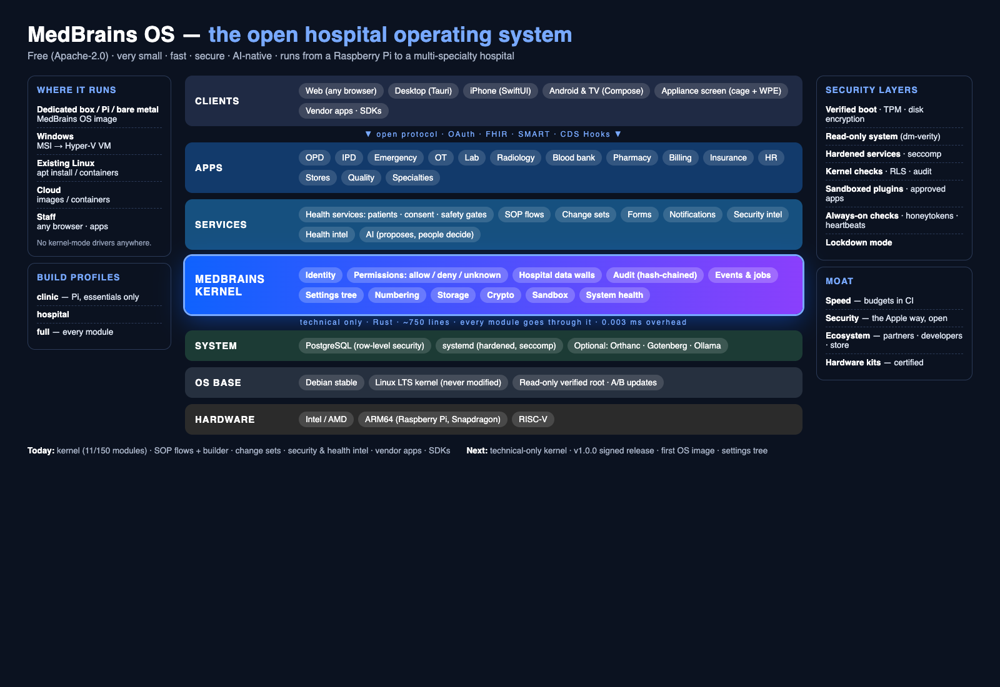
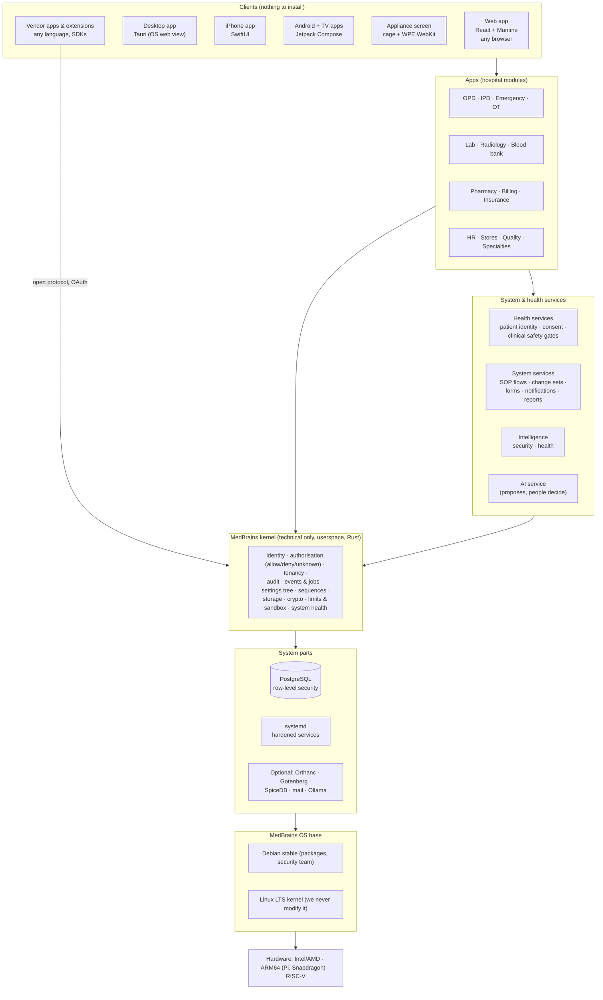
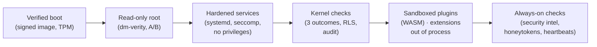
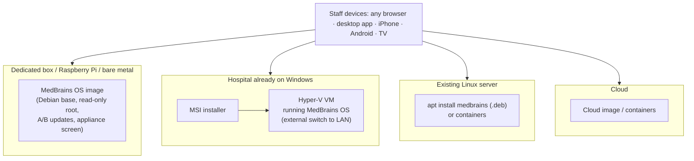
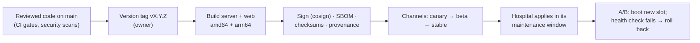

# MedBrains OS — architecture

**What it is:** a world-class, AI-native hospital operating system that costs almost nothing to run.
Free and open (Apache-2.0), very small, fast and secure, from a Raspberry Pi in a clinic to a
multi-specialty hospital.

**Decisions this document reflects:** `RFCs/RFC-HOSPITAL-OS.md` (the plan), `docs/OS-PRINCIPLES.md`
(the law), `docs/research/OS-PLATFORM-LESSONS.md` (what we learnt from big platforms).

Status markers: **[today]** exists on `main` · **[building]** in progress · **[planned]** in the RFC.

---

## 1. The layers



Editable version: [`medbrains-os-architecture.excalidraw`](medbrains-os-architecture.excalidraw) (open at excalidraw.com → Open).



**Rules between layers**
- Everything above the kernel reaches shared concerns **only through the kernel** (enforced by
  `make check-kernel-boundary`, a CI ratchet). **[today]**
- The kernel is **technical only**: it knows nothing about patients, drugs or bills. Hospital
  concepts live in health services. **[planned: K3a moves patient/consent out]**
- Extensions never touch the database; they call the kernel through the open protocol. **[today: C1/E1]**
- Safety gates are code, never configuration; flows and plugins can add checks, never remove them.

## 2. The kernel

Crate: `crates/medbrains-kernel` (~750 lines; budget ≤ 2,000). **[today: K1, K2]**

| Module | Purpose | Interface |
|---|---|---|
| `work` / `begin` | one unit of work: a tenant-scoped transaction with RLS context and the acting user/app | `kernel::work(pool, actor, \|tx\| …)` |
| `authz` | one decision function, three outcomes; batched for lists | `authorize`, `authorize_many` → `Allow \| Deny \| Unknown` |
| `audit` | append-only, hash-chained audit entry in the same transaction | `kernel::audit(tx, event)` |
| `events` | before-events (gates that can refuse) and after-events (queued in the same transaction, dropped on rollback) | `events::before`, `events::after` |
| `config` | settings by path; today hospital scope, tomorrow the full tree | `config::get(tx, "discharge/tpa_required")` |
| `seq` | atomic numbers (UHID, tokens, invoices) | `seq::next(tx, "uhid")` |
| `store` | object storage with tenant-scoped keys (S3 or local disk) | `store::put`, `store::get` |
| `health` | the system's own health (RLS role, authz backend, heartbeats) | `health::rls_mode` |
| `patient`, `consent` | **moving to health services** (§3a of the RFC) | — |

**Kernel guarantees**
1. **Fail-safe:** missing context or an outage is `Unknown`, never `Allow`; a refusal looks like
   "not found" so it isn't an existence oracle; an outage is never shown as an empty list.
2. **Complete mediation:** every access is checked, every time.
3. **Atomic:** work, its audit entry and its after-events commit or roll back together.
4. **Zero-cost:** thin, inlined wrappers; measured overhead **0.003 ms** per unit of work
   (budget 0.2 ms).
5. **Memory-safe:** Rust, `unsafe` forbidden, panics denied by lints.

## 3. A request, end to end

```mermaid
sequenceDiagram
    autonumber
    participant U as Clinician (browser)
    participant S as Server (Axum)
    participant K as Kernel
    participant H as Health services
    participant DB as PostgreSQL (RLS)
    participant Q as Job queue / outbox

    U->>S: POST /api/... (session or app token)
    S->>K: kernel::work(actor)
    K->>DB: BEGIN; set tenant + actor context (RLS)
    K->>K: authorize(action, resource)
    alt Unknown (fault)
        K-->>S: 503, nothing written
    else Deny
        K-->>S: 404 (not an existence oracle)
    else Allow
        S->>H: domain action (e.g. dispense)
        H->>K: safety gate (before-event) — can refuse
        H->>DB: write domain rows (RLS enforced)
        H->>K: audit(event) — hash-chained, same tx
        H->>K: events::after — queued in same tx
        K->>DB: COMMIT (all or nothing)
        Q-->>Q: worker delivers webhooks / reactions after commit
        S-->>U: 200
    end
```

## 4. Security model (defence in depth)



| Layer | Mechanism | Status |
|---|---|---|
| Boot | signed images, secure boot, TPM, disk encryption (LUKS) | [planned SEC3] |
| System | dm-verity read-only root with A/B fallback | [planned SEC3] |
| Services | own unprivileged user each, systemd hardening, seccomp allow-list | [planned SEC5] |
| Code | Rust, no `unsafe`, compile-time-checked SQL | [today] |
| Data | PostgreSQL row-level security per hospital; app connects as a non-owner role | [today] |
| Access | three-outcome authorisation, per-record checks, field masking, MFA | [today] |
| Audit | append-only, hash-chained; hourly verification | [today]; Merkle + external anchoring [proposed] |
| Change | knowledge/flow changes previewed, second-person approval, rollback, proof | [today] |
| Extensions | OAuth apps approved per hospital, least privilege, revocable; privacy labels | [today C1] |
| Plugins | WASM sandbox, time-boxed, signed | [planned K4] |
| Watch | continuous checks, honeytokens, vulnerable packages, heartbeats ("watch the watchers") | [today P1] |
| Lockdown | one switch for high-risk hospitals | [planned SEC6] |

## 5. Extension model

```mermaid
flowchart LR
    DEV["Developer<br/>(any language)"] -->|"medbrains ext init / test"| SDK["SDKs: TypeScript, Python<br/>+ CLI + mock"]
    SDK --> MAN["Manifest<br/>(purpose, events, reads,<br/>permissions, data classes)"]
    MAN --> REG["Registry<br/>community / certified"]
    REG --> ADM["Hospital admin<br/>sees privacy label,<br/>approves / revokes"]
    ADM --> TOK["OAuth client credentials<br/>15-min tokens, exact grants"]
    TOK --> KER["Kernel<br/>(permissions, consent, audit)"]
    KER --> WH["Signed webhooks<br/>(HMAC, replay window, retries)"]
```



Three ways to build: **in-tree Rust modules on the kernel facade** [today]; **WASM flow blocks**
[planned K4]; **out-of-process extensions in any language** [today: protocol, SDKs, CLI; registry E2
planned]. Standards first: FHIR R4, SMART on FHIR, CDS Hooks [partly; C3/C4 planned].

## 6. Where it runs



No kernel-mode drivers anywhere: printers via IPP/CUPS, scanners as keyboards (HID), analysers via
HL7 over network/serial in userspace, imaging via DICOM. **Images:** [planned D1–D4]. **Containers:**
amd64 + arm64 [today]. **Windows MSI + Hyper-V:** [planned W1]. **.deb:** [planned].

**Profiles (small by design):** `clinic` (Pi: patients, OPD, billing, pharmacy, lab basics),
`hospital`, `full` — compiled in, so a clinic build doesn't carry specialties. [planned SM2]

## 7. Process and storage layout (appliance)

| Unit | Runs as | Notes |
|---|---|---|
| `medbrains-server.service` | `medbrains` (unprivileged) | API + web; kernel inside; hardened |
| `medbrains-worker.service` | `medbrains-worker` | job queue, outbox, webhooks, security/health checks |
| `postgresql.service` | `postgres` | app connects as `medbrains_app` (no RLS bypass) |
| `medbrains-bridge.service` | `medbrains-bridge` | HL7/device bridge; only its devices |
| `cage-console.service` | `kiosk` | appliance screen (cage + WPE) |
| optional | own users | Orthanc, Gotenberg, SpiceDB, mail, Ollama |

Disks: EFI · root A · root B (read-only, verified) · recovery · **encrypted data** (database, files,
backups, logs). Writable state lives only on the data partition. Hardware safety: NVMe not SD,
watchdog, UPS clean shutdown, thermal and disk-health checks (RFC §8o).

## 8. Updates and releases



Security fixes: critical ≤ 72 h, high ≤ 7 days, medium ≤ 30 days. Semantic versioning; the kernel
interface, extension protocol and SDKs promise not to break builders within a major version.
[release pipeline today; signing, SBOM, channels, compatibility promise building]

## 9. Budgets (measured, enforced)

| Budget | Target | Today |
|---|---|---|
| Kernel overhead per unit of work | < 0.2 ms | 0.003 ms |
| Kernel size | ≤ 2,000 lines, no domain deps | ~750 lines |
| Screen API p95 | < 50 ms server / < 150 ms Pi 5 | to measure (S1) |
| Critical alert end to end | < 2 s | to measure |
| OS image | ≤ 1 GB | not built |
| Idle memory, appliance (Pi 5) | ≤ 512 MB | to measure |
| Dependencies | ratchet down | 1,319 packages |
| Modules on the kernel | all 150 | 11 |

## 10. Principles behind every choice

Mechanism in the kernel, policy above it. Fail-safe defaults. Complete mediation. Least privilege.
Separation of privilege (two-person approval). Crash-only, idempotent, bounded. Stable interfaces;
never break builders. Open design (secure with the code public). Zero licence cost. Small, fast,
secure — measured, not claimed. See `docs/OS-PRINCIPLES.md`.

## 11. What exists vs what's next

**Today:** kernel K1/K2 (11/150 modules), SOP flows + switchboard + track builder, knowledge change
sets, security intelligence P1, health intelligence P1, connected apps (C1), extension protocol +
SDKs + CLI (E1), provenance markers, release pipeline, CI security scans.

**Delivery order:** see RFC-HOSPITAL-OS §8b: `.deb` (D0), image (D1), offline installer (D2), then
VM images and A/B updates. Filesystem snapshots stay out until the FS1 test passes.

**Next:** K3a technical-only kernel · SM1 size budgets in CI · release v1.0.0 (signed, SBOM,
compatibility promise) · GitHub Actions on free runners + cross-OS GUI tests · D1 first Debian-based
MedBrains OS image with the appliance screen, tested in QEMU · K3 settings tree · porting batches.
