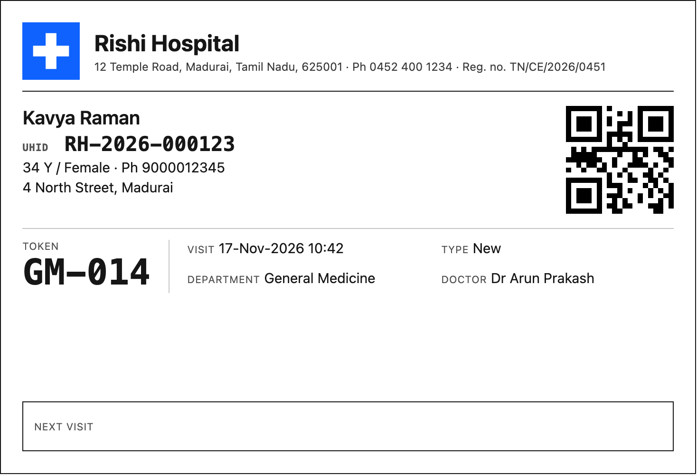
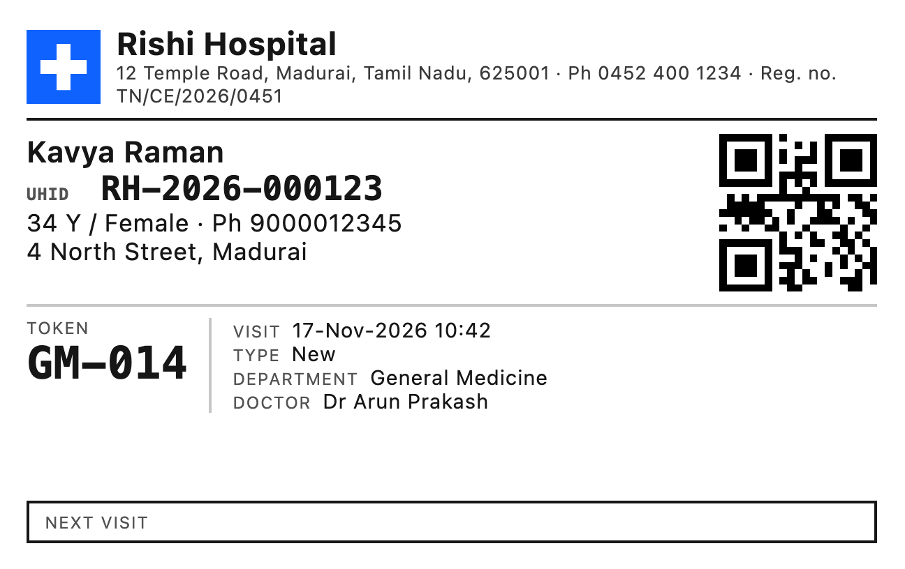

# SOP: Patient Registration

## Overview
Patient Registration is the entry point for all clinical care in MedBrains. It creates the master patient record, assigns a system-wide Unique Health ID (UHID), and links the patient to subsequent encounters across OPD, IPD, Emergency, and other modules. Registration can be initiated by the patient themselves (kiosk / web portal), by front-desk staff, by a nurse in an emergency, or pre-populated via ABDM Health ID linkage. Every registered patient must have at least two identifiers per NABH and IPSG standards.

## Actor Matrix

| Actor (Role) | Can Perform | Notes |
|---|---|---|
| `patient` (public/unauthenticated) | Self-register at kiosk or online portal | Generates UHID; no staff intervention needed |
| `receptionist` | Walk-in registration, edit demographics, print token | Full access to patient master |
| `front_office_staff` | Walk-in registration, phone pre-registration | Same page access as receptionist |
| `nurse` | Emergency bedside registration with minimal data | Can create record without photo ID if patient is critical |
| `hospital_admin` / `super_admin` | All of the above + merge duplicate records | Merge requires audit trail |

---

## Scenario 1: Self-Registration at Kiosk — Actor: Patient (public)

**Actor**: `patient` (unauthenticated, public kiosk session)  
**Entry point**: Patient walks up to kiosk, taps "New Registration"  
**Preconditions**: Kiosk is online; tenant has at least one active OPD department and one doctor schedule

**Steps**:
1. Patient enters full name, date of birth, sex, and mobile number.
2. System checks for existing record by mobile number; if found, prompts "Existing record found — log in or continue as new".
3. Patient confirms no existing record → system generates UHID (format: `UHID-YYYYNNNNNN` via `^SEQUENCE` YottaDB global).
4. Patient selects department and preferred doctor (or "Any Available").
5. System issues OPD token (format: `T-NNN`) and appointment slot confirmation.
6. Kiosk prints or displays QR code for token.

**Exit / Outcome**: UHID created, OPD appointment token issued, patient record in `patients` table with `registration_source = 'kiosk'`.  
**Regulatory note**: NABH OPD.1 — two-identifier check (name + DOB or mobile); IPSG Goal 1 patient identification.  
**Existing test**: JNY-PAT-001 in `apps/web/e2e/scenarios/actor-perspective-journeys.spec.ts` (automated)

---

## Scenario 2: Walk-in Registration by Receptionist — Actor: Receptionist

**Actor**: `receptionist`  
**Entry point**: Front desk staff opens Patients → New Patient from the sidebar  
**Preconditions**: Staff is logged in with `receptionist` role; OPD department exists

**Steps**:
0. Before registering, the receptionist searches the Patients box, which takes a name, phone, UHID or Aadhaar: every word of a name must match ("sample asha" and "ash sam" find Asha Sample); a phone matches in any form ("90000 12345", "+91 90000 12345", "09000012345", or its last digits); a UHID matches in any case, exact first; twelve digits are an Aadhaar number, matched by its keyed fingerprint and never shown in full (type a 12-digit phone with `+91`).
1. Receptionist opens the New Patient form (route: `/patients/new`).
2. Fills step 1's **Required details**, top to bottom in Tab order: first name (last name beside it, optional), sex, age (or date of birth; either is enough), phone (or ticks "Has no phone"), then the department (hidden when the hospital has one; required while "Send to OPD queue" is ticked) and doctor. A tick above them marks an unknown / unidentified patient, which waives name, sex, age and phone. Below, **More details (optional)** holds prefix, middle name, name in own script, blood group and a second phone; the address is asked on a later step.
3. Optionally scans Aadhaar / ABHA card → auto-populates demographics via ABDM lookup.
4. Attaches photo (webcam capture or upload).
5. Selects registration type: General / Corporate / TPA / Government.
6. System validates no duplicate by mobile + DOB combination; warns if near-match found.
7. Receptionist confirms and submits → UHID generated and printed on registration slip.
8. Patient is queued for selected OPD department.
9. The "patient registered" notice offers **Print OPD card**: the half-A4 OPD slip or the CR80 ID card. Headed with the hospital's name, logo, address, phone and registration number from its own profile (Admin → Settings → General and Branding); carries name, UHID with a QR of it, age and sex, phone, short address and, when a visit was opened, its date and time, department, doctor, token and new-or-repeat. No next-visit box: the card is printed once and kept, so the next visit is told to the patient or written on the prescription. No clinical data. The same control is on the OPD queue row (the visit's card) and the patient record header. Gated on `patients.view` and the patient's access check, or, when there is no relationship, on `patients.card.reprint` (the desk, any patient of the hospital, printed without the address and recorded as a desk reprint); data from `GET /api/print-data/opd-card/{patient_id}` and `/api/print-data/opd-visit-card/{encounter_id}`.
   Sample, fictional hospital and patient:  
10. After registering, the screen stays on the new patient's record (with the notice above). **Open OPD after registration** is unticked by default; tick it to go straight to the visit instead. Camp registration keeps its own setting (on while the EMR is on).

**A single-department hospital**: create one department named **General** (code `GEN`, type clinical, active) in onboarding or under Admin → Settings → Departments. The department field then disappears from registration and from New OPD visit, and every visit goes to General. Staff choose only the patient and the doctor. The token does not come from the department's name or code: without a configured token queue an OPD token reads `T-001`, `T-002`, … each day; a queue set up under Queues (`/admin/queues`) prints its own prefix instead. A hospital with two or more active clinical departments sees the picker as before.

**Exit / Outcome**: UHID assigned, physical registration slip printed, patient record status `active`.  
**Regulatory note**: NABH OPD.1; Clinical Establishments Act 2010 §38 (patient records); PCPNDT — sex field mandatory.  
**Existing test**: `apps/web/e2e/forms/patient-register.spec.ts` (partial — form validation only); `— needs full journey test`

---

## Scenario 3: Emergency Bedside Registration — Actor: Nurse

**Actor**: `nurse`  
**Entry point**: Patient arrives at Emergency / Casualty; nurse opens Emergency module → New Encounter → "Register New Patient"  
**Preconditions**: Nurse logged in; Emergency department exists; patient cannot self-register (unconscious, critical)

**Steps**:
1. Nurse selects "Emergency Registration" which launches a minimal-field form.
2. Enters available info: estimated age, sex, chief complaint, arrival mode (walk-in / ambulance / police).
3. If no ID available, system assigns a temporary identifier `TEMP-YYYYMMDD-NNN`.
4. Triage level assigned immediately (colour tag: Red / Orange / Yellow / Green) — mandatory before proceeding.
5. Emergency encounter opened; doctor and bed assigned.
6. Full demographic data collected later (by receptionist or patient's relative) and linked to the TEMP record.
7. Once full data collected, TEMP record promoted to permanent UHID; merge logged in audit trail.

**Exit / Outcome**: Emergency encounter open with triage tag; TEMP or permanent UHID linked; bed assigned.  
**Regulatory note**: MLC documentation required if police/accident case (IPC §39 / CrPC §174); IPSG Goal 1 — both ID points documented at earliest opportunity.  
**Existing test**: `— needs test` (JNY-HOS-001 covers OPD registration, not emergency fast-track)

---

## Scenario 4: Phone Pre-Registration by Front Office Staff — Actor: Front Office Staff

**Actor**: `front_office_staff`  
**Entry point**: Staff receives phone call from patient; opens Patients → Pre-Registration  
**Preconditions**: Staff logged in; patient calling to book an appointment ahead of arrival

**Steps**:
1. Staff opens pre-registration form; enters name, mobile, DOB, and reason for visit.
2. System checks for existing UHID by mobile → if found, links appointment to existing record.
3. If new patient: creates a record with status `pre_registered`; no UHID issued yet.
4. Staff books OPD slot for requested doctor/department and confirms with patient verbally.
5. System sends SMS confirmation with appointment time and directions.
6. On arrival: receptionist searches by mobile / pre-registration reference, upgrades status to `active`, issues UHID and prints registration slip.

**Exit / Outcome**: Pre-registration record created with `status = pre_registered`; appointment slot held; SMS sent.  
**Regulatory note**: NABH OPD.1; Consumer Protection Act 2019 — accurate appointment info must be communicated.  
**Existing test**: `— needs test`
